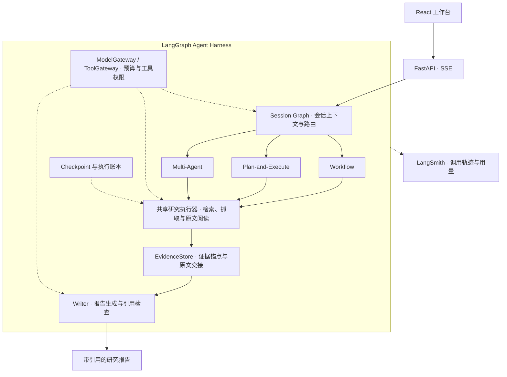

# DeepResearch

[](https://github.com/1785454358/agent/actions/workflows/ci.yml)
[](LICENSE)

**从一个研究问题，到一份有来源、可追溯的回答。**

DeepResearch 是基于 LangGraph 的多模式深度研究 Agent。它将问题拆解、联网搜索、网页阅读与回答生成串成完整流程，并通过 Web 工作台展示研究进度、工具调用、最终回答和资料来源。

面向行业研究、竞品分析和技术调研，项目通过 Auto 在 Workflow、Plan-and-Execute、Multi-Agent 三种模式间路由。三种模式共用证据存储、模型与工具网关、运行预算和 Checkpoint。

[快速体验](#快速体验) · [作品 PDF](docs/showcase/DeepResearch_项目作品介绍.pdf) · [实跑录屏](docs/showcase/DeepResearch-Stock-Idempotency-Demo.mp4) · [完整案例](docs/showcase/case-stock-idempotency.md) · [当前架构](docs/architecture/delivery-first-runtime.md)

## 可以用它做什么

| 场景 | 输入示例 | 研究过程 |
| --- | --- | --- |
| 技术文档研究 | “对比 Python 3.11 的 TaskGroup 与 gather 的异常行为，并附官方出处” | 拆分问题、检索官方资料、阅读原文、组织带来源的回答 |
| 方案对比 | “从持久化、故障恢复和工具调用三个方面比较两种 Agent 方案” | 按维度建立研究任务，汇总支持各项结论的证据 |
| 多方向调查 | “分别调查某项技术的原理、应用和部署条件” | 并行研究不同方向，再用已有原文生成报告 |

上表列出适用场景；完整运行记录见下方案例。

## 快速体验

无需 API Key，先体验工作台与三种策略的执行过程：

```bash
git clone https://github.com/1785454358/agent.git
cd agent/frontend
npm ci
npm run showcase
```

打开 [http://127.0.0.1:5173](http://127.0.0.1:5173)，选择研究策略并加载示例，即可查看执行轨迹、回答、来源和运行规则。

演示页面使用固定示例数据，标记为 `SHOWCASE DATA`。连接真实模型与搜索服务的运行步骤见[运行真实研究](#运行真实研究)。

需要展示真实新对话时，可在真实 API 启动后，于 `backend` 执行 `uv run --no-sync python scripts/record_demo.py`，自动从“新研究”开始录制完整流程，并检查终态、回答、编号引用和浏览器异常。脚本输出浏览器原始视频与结果工件，不会用固定数据替换 API。最近两次实测与展示修复见[新对话验收记录](docs/benchmarks/2026-11-18-new-conversation/README.md)。

## 实跑展示

> 订单消息会重复投递。用 Kafka 或 SQS FIFO 时，库存扣减和消息确认应该按什么顺序做？数据库提交前后分别宕机，怎么测试？

Agent 自动选择 Multi-Agent，并行读取 Kafka、Amazon SQS 和 PostgreSQL 的官方资料，交付确认顺序对比、数据库幂等方案和故障测试步骤。报告建议在同一个事务中写入幂等记录并扣减库存，事务提交后再确认消息。

| 运行指标 | 本次记录 |
| --- | --- |
| 路由 | Auto → Multi-Agent |
| Agent 耗时（资料入库后） | 14.812 秒 |
| 模型调用 | 8 次 |
| Token | 输入 8,744，输出 1,969，合计 10,713 |
| 引用 | 5 篇官方文档 |

本次回放使用预先收集并导入的官方文档，关闭额外事实复核。计时覆盖自动路由、并行读证与报告生成。测试步骤是报告给出的验证方案。[下载录屏](docs/showcase/DeepResearch-Stock-Idempotency-Demo.mp4) · [完整回答与引用](docs/showcase/case-stock-idempotency.md)

另有一例从搜索到报告生成的完整联网运行，见 [Python TaskGroup 与 gather 技术调研](docs/showcase/case-asyncio.md)。


## 技术亮点

### 三种策略，共享一套运行时

| 策略 | 编排方式 | 适用任务 |
| --- | --- | --- |
| Workflow | 一次计划，按固定任务顺序收集材料 | 研究边界清楚、流程稳定的任务 |
| Plan-and-Execute | 逐项收集，后续任务可复用前面取得的获准来源 | 存在依赖、需要逐步深入的问题 |
| Multi-Agent | 一次拆分多个独立任务，有界并行收集后汇总 | 可以拆成多个独立方向的调查 |

三种策略统一接收 `ResearchInput`，输出 `ResearchOutcome`，复用模型调用、工具治理、上下文、预算与退出规则。

工作台、API 和 CLI 默认使用 `auto`：模型分析任务是否有执行依赖、是否有多个独立研究方向、是否属于范围明确的查询，再由程序选择策略。有步骤依赖时选择 Plan-and-Execute；否则有多个实质独立方向时选择 Multi-Agent；其余范围明确的单方向任务选择 Workflow。路由最多调用一次模型，计入原有运行预算；分类失败回退 Workflow，取消及预算存储故障仍向上传播。页面显示真实选中模式和原因，仍可手动指定三种模式做对照。

`DEEPTRACE_RESEARCH_ORCHESTRATOR` 的 `strategies`、`legacy` 和 `controller` 目前均使用同一个精简主干，配置名称仅作兼容。三种模式保留任务顺序、来源复用与并行方式的差异，生产研究循环不再逐轮做事实全覆盖评估或缺口重规划。`auto` 仍是一次动态路由，可手动覆盖。

研究只做一次短计划，再在预算内搜索、抓取和阅读。结束后直接把实际读到的原文坐标交给 Writer；普通问题写一次，代码/方案等问题可用同一份原文做一次就地修订。局部分支失败和资料缺口写入限制，不清空其他成果。完全没有可用原文、取消或服务故障仍如实返回。

**报告交付与依据充分分开表达。** 新流程的 `completed` 表示已交付有效报告，`research_sufficiency` 仍可能为 `unknown` 或 `insufficient`；不能将完成状态当作正确率。旧结果不批量改状态，旧版未结束任务须用原版本恢复或另开新运行。详见[当前架构与迁移边界](docs/architecture/delivery-first-runtime.md)。

### 从搜索结果到可追溯证据

搜索发现来源，网页抓取保存正文，阅读工具按问题选取原文。实际阅读范围保留证据标识、原文位置、版本与内容 hash；写作前重新检查这些标识和正文 hash。引用只允许使用实际可见的来源。事实覆盖评估保留在离线验证中，不再控制生产研究退出。

科研进展任务可在初始规划中安排候选筛选与定向阅读，并在交付阶段检查原创成果来源及发表日期。

这一链路将“找到网页”和“形成有依据的结论”连接起来，也为复查引用与分析回答质量提供数据。

### 为长任务建立运行边界

- **统一调用入口**：`ModelGateway` 管理模型调用，`ToolGateway` 管理工具权限、URL 校验、并发、预算与重试。
- **明确执行结果**：`AgentOutcome` 包含运行状态、答案、证据、预算、错误与未完成任务。
- **分层恢复机制**：工具 Gateway 处理传输重试，整理阶段处理有界格式修复，Worker、Checkpoint 与 Ledger 支持任务恢复和执行记录复用。
- **会话与记忆**：Session Graph 管理策略路由和会话生命周期，支持关键词召回及本地语义记忆。
- **过程可观测**：FastAPI 与 SSE 将运行事件推送到前端，工作台展示进度、历史运行、回答与来源。
- **预算与实际用量**：调用前持久化保守预留，跨实例恢复原始额度和期限；生产展示供应商已返回的用量，缺失时明确为未知。

运行时另提供小的工具循环与可注册 ToolSpec，用独立文档任务验证领域外复用。默认研究仍采用批量执行器；[本轮优化与验收](docs/architecture/2026-10-10-harness-runtime-implementation.md)记录实现与限制。

在 `backend` 目录可运行无需 Key 的第二任务示例：

```powershell
uv run --no-sync python -m deeptrace.examples.local_documents README.md --root .. --offline
```

示例采用脚本模型与真实只读工具，限制目录、文件类型、大小与预览，明确报告未知 usage。它用于验证循环、权限、预算和账本，不代表真实模型质量测试。

## 架构



来源权限、总预算、usage、工具账本与检查点恢复沿用现有底座。新主干不依赖逐轮全覆盖核验。

本地模式采用进程内执行器与 SQLite 持久化。分布式模式采用 MySQL、Redis Streams、独立 Worker 与 Chroma，分别承载运行数据、任务投递、执行和语义索引。

技术栈：Python · LangGraph · FastAPI · SQLAlchemy · Redis · Chroma · React · TypeScript · Vite · Docker。

## 运行真实研究

准备 Python 3.11 或 3.12、uv、Node.js，以及支持 tool calling 的 OpenAI-compatible 模型与 Tavily 凭据。

```powershell
cd backend
Copy-Item .env.example .env
# 在 .env 中填写 OPENAI_API_KEY、OPENAI_BASE_URL、OPENAI_MODEL 和 TAVILY_API_KEY
# 关键词记忆模式设置 DEEPTRACE_MEMORY_RETRIEVAL=lexical
# 语义记忆模式需另配置本地 BGE-M3 模型路径
uv sync --locked
uv run playwright install chromium
uv run python -m deeptrace.api
```

另开终端启动前端：

```bash
cd frontend
npm ci
npm run dev
```

前端地址：[http://127.0.0.1:5173](http://127.0.0.1:5173)。API 地址：[http://127.0.0.1:8001](http://127.0.0.1:8001)。

## Docker 打包

镜像内包含前端工作台、后端和 Chromium，在仓库根目录执行：

```bash
docker build -f backend/Dockerfile -t deepresearch:0.2.0 .
```

配置 `backend/.env` 后，可直接启动单机模式：

```bash
docker run --rm -p 127.0.0.1:8000:8000 --env-file backend/.env -e DEEPTRACE_RUNTIME_MODE=local -e DEEPTRACE_MEMORY_RETRIEVAL=lexical --mount source=deepresearch-runs,target=/app/runs deepresearch:0.2.0
```

打开 [http://127.0.0.1:8000](http://127.0.0.1:8000)。Linux 镜像采用 CPU 版 Torch，Windows 本地开发保留 CUDA 版。分布式 Compose、镜像验收及导出步骤见 [Docker 部署指南](docs/deployment/docker.md)。

## 测试与工程验证

当前确定性验证覆盖 Runtime、三种策略、工具治理和持久化；测试命令如下。云端评测统一使用 [LangSmith](docs/architecture/langsmith.md)，现有 30 道参考题，支持调用树、模型耗时与 Token、工具成功率和答案正确性反馈；原独立评分镜像已退役。

```powershell
cd backend
uv run pytest -m "not real"

cd ../frontend
npm run lint
npm test
npm run build
npm run build:showcase
```

测试覆盖策略编排、工具与模型边界、消息配对、证据引用、预算、记忆、恢复及分布式租约。真实模型和外部服务测试单独运行。CI Badge 对应 GitHub 上已提交的版本。

## 源码入口

| 关注点 | 入口 |
| --- | --- |
| 会话管理与策略路由 | [harness/graph.py](backend/src/deeptrace/harness/graph.py) |
| 自动研究模式选择 | [harness/mode_routing.py](backend/src/deeptrace/harness/mode_routing.py) |
| 默认研究编排 | [research/runtime.py](backend/src/deeptrace/research/runtime.py) |
| 共享批量研究执行器 | [harness/batch_research.py](backend/src/deeptrace/harness/batch_research.py) |
| 共享模型请求与输入预算 | [harness/model_budget.py](backend/src/deeptrace/harness/model_budget.py) |
| 模型调用边界 | [harness/model_gateway.py](backend/src/deeptrace/harness/model_gateway.py) |
| 工具治理与执行记录 | [tools/gateway.py](backend/src/deeptrace/tools/gateway.py) |
| 离线证据评估与覆盖检查 | [strategies/evidence_evaluation.py](backend/src/deeptrace/strategies/evidence_evaluation.py) |
| 回答的证据装配 | [responses/evidence.py](backend/src/deeptrace/responses/evidence.py) |
| 记忆生命周期 | [harness/memory/lifecycle.py](backend/src/deeptrace/harness/memory/lifecycle.py) |

更多说明见[当前架构](docs/architecture/delivery-first-runtime.md)与[本轮实测](docs/benchmarks/2026-11-19-delivery-first.md)。

## 开源参考

研究了 [Open Deep Research](https://github.com/langchain-ai/open_deep_research)、[GPT Researcher](https://github.com/assafelovic/gpt-researcher) 与 [DeerFlow](https://github.com/bytedance/deer-flow) 的研究编排和产品展示方式。DeepResearch 围绕共享运行时、证据交接与可验证的执行规则组织实现。详见[设计参考与演进方向](docs/showcase/mature-projects.md)。

项目采用 [MIT License](LICENSE)。
