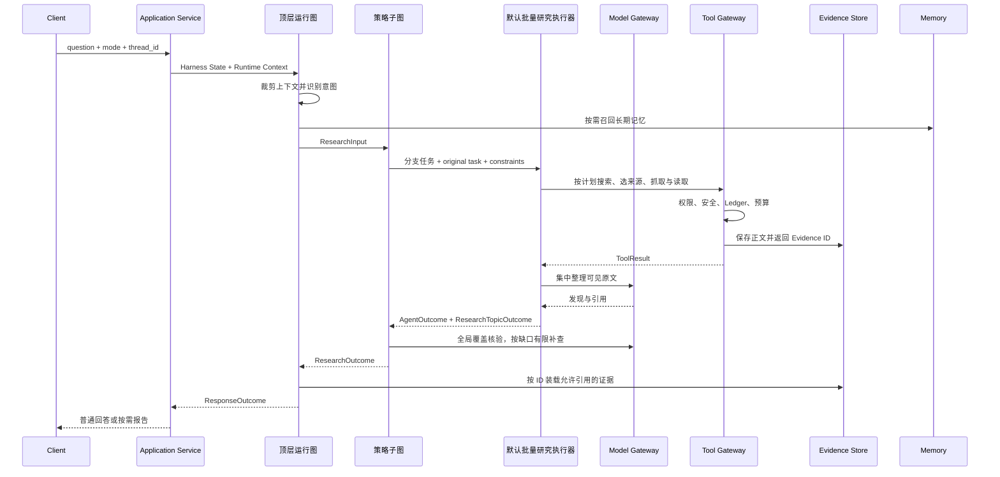

# DeepResearch 后端

后端已经统一到 LangGraph Agent Harness。旧 Basic、Deep 和手写 ReAct 目录不再参与执行。当前三个研究模式分别对应 Workflow、Plan-and-Execute 和 Multi-Agent 策略子图。

## 一次请求怎样执行



三个 orchestration strategy 共享运行治理与默认批量执行器 `harness/batch_research.py`。顶层 Session Graph 位于 `src/deeptrace/harness/graph.py`，管理上下文、记忆、策略和响应。可选研究工具循环保留为独立执行方式，下面说明其边界；不是所有生产分支都逐工具调用模型。

默认 v3 批量路径先选择直接相关的候选来源，再交付实际读取的原文锚点，父级统一核验覆盖；不再额外生成分支摘要。Workflow 在仍有有效需求缺口时最多补查一轮、两条新查询，使用同一份预算与授权。抓取器的 `max_page_chars` 约束序列化预览；完整正文在既有传输/证据大小上限内独立入库，不直接扩大模型窗口。实现、真实效果及未解决项见[优化实测](../docs/benchmarks/2026-10-24-research-recovery/results.md)。

来源选择还可返回按需求 ID 约束的原文语言读取查询；读取 query 随实际锚点传给核验，只作定位提示，不作事实支持。提取保留列表、表格和实质代码，窗口优先保留完整因果条件与独立焦点。Workflow 初始规划和候选选择遇明确短暂模型连接错误时最多再派发一次，仍逐次经过共享预算；SDK 不叠加隐式重试。效果与局限见[读取修复实测](../docs/benchmarks/2026-10-25-reading-fidelity/results.md)。

Workflow 的缺口补查现可先选择已保存来源的真实段落，最多补读一次、两段（每段不超过 900 字符），重新核验后才派发仍有需要的备用搜索。段落导航只用于选择；执行前复核授权、版本和哈希，读取仍经过 ToolGateway 与 Ledger。新读段落优先进入原有核验窗口，完成读取不代表需求已覆盖。若只规划了补读且仍不足，允许再规划一次搜索；新搜索仍最多一轮、两条查询，共享预算不增加。固定材料、失败重放和完整联网结果见[缺口回读实测](../docs/benchmarks/2026-10-25-gap-reread/results.md)。

## 自动模式路由与编排选择

新研究请求默认 `mode=auto`。`harness/mode_routing.py` 通过一次共享预算内的模型调用分析任务特点；宿主按“执行依赖 → Plan-and-Execute、否则多个实质独立方向 → Multi-Agent、其余单方向任务 → Workflow”的规则选择具体模式。手动指定模式跳过分类调用；普通追问、记忆写入和报告转换不调用研究模式分类器。分类失败回退 Workflow，取消和预算存储失败不会被吞掉。

选择在 checkpoint 中保存，并通过 `research.routed` 事件持久化。详情 API 保留请求的 `mode`，另返回 `selected_mode` 和 `routing_reason`。因此 auto 会话的后续请求仍能根据新任务重新选择；已中断的原运行恢复时沿用保存的选择。

默认 `DEEPTRACE_RESEARCH_ORCHESTRATOR=strategies` 装配现有三个独立策略子图，`legacy` 是兼容别名。Workflow 使用稳定的规划/取材/核验及有界恢复，Plan-and-Execute 按序执行并有限重规划，Multi-Agent 使用 Supervisor 分派与并行 Researcher、汇总和后续补查。它们共享批量取材、工具和模型预算、证据验证与 Writer。

## 统一研究内核（显式对照配置）

`DEEPTRACE_RESEARCH_ORCHESTRATOR=controller` 显式启用同一套“规划 → 有界任务执行 → 验证 → 定向补读/补查”研究图。API、Worker 和三种对外模式均通过同一个生产装配入口选择。Plan-and-Execute 顺序执行，其余模式有界并行；因此该对照配置不体现三个独立策略的全部编排差异。

内核复用已有范围审查、批量取材、证据验证及 Writer。任务结果独立写入现有 checkpoint，成功分支在中断后复用；补查追加计划 revision，只派发未覆盖目标。任务尝试受模型调用和页数上限约束，总额度与原始截止时间仍由持久化 RunBudget 管理。中断中的外部请求可能再次执行，不保证供应商 exactly-once。

controller 当前只启用批量 retrieve 能力，其他执行器在执行前拒绝。已经中断的运行应沿用其原始 orchestrator 配置恢复，切换配置不是旧 checkpoint 的转换器。统一内核的历史方案见[架构方案](../docs/architecture/2026-11-14-controller-refactor-design.md)。

研究契约中的需求不可原地修改，调整目标需要新 revision。独立持久化研究图可以在同一 thread 处理后续 run：新输入会清空上次的任务结果、证据与验证，`ainvoke(None, ...)` 则恢复中断的原运行。评测使用 `--orchestrator controller` 或 `--orchestrator legacy` 明确选择路径，实际配置会写入实验 metadata；完整对比方式见 [LangSmith 文档](../docs/architecture/langsmith.md)。

## 共享循环与治理边界

- `harness/loop.py`：六个显式节点的共享路由，不包含 ResearchTopicInput 或 Finding；`agent_executor.py` 提供研究领域节点，`examples/local_documents.py` 提供独立文档任务。
- `harness/prompts.py`、`model_context.py`：研究提示与结构化 TaskContext；校验不再扫描中文标签。
- `harness/policies/agent_context.py`：逐轮重建模型输入视图，保留当前任务/约束/计划，只按完整工具交互组裁剪历史；持久化轨迹保持完整。
- `harness/agent_tools.py`：工具协议、依赖分组、有界并行（默认 4），稳定归并；所有外部执行必经 ToolGateway。
- `harness/model_gateway.py`：模型 I/O、任务信封、超时与稳定错误；生产通过 `application/model_provider.py` 配置单次传输尝试与角色超时，SDK 重试关闭。
- `harness/model_budget.py`：调用前持久化次数与输入预留，结算实际 usage 或保守估算；恢复原始期限／额度，SQL 版本冲突或存储不可用时拒绝派发。
- `observability/model_metrics.py`：生产 Local/Worker 的实际用量与模型角色耗时；缺失 usage 总量为 null，model.* 事件不公开 prompt，终态释放每 run 资源。
- `harness/policies/execution.py`：完成条件、轮数/错误上限、结构化退出。`domain/agent.py` 的 AgentOutcome 包含 status、stop_reason、summary、evidence_ids、errors、iterations、执行计数和计划进度。
- `harness/memory/lifecycle.py`：请求前召回、显式记忆写入、研究后归纳。可选召回不可用时记录降级，继续处理原始任务。

三类重试互不替代：

| 类型 | 归属 | 边界 |
| --- | --- | --- |
| Transport retry | ModelGateway / ToolGateway | 各自有限重试短暂 I/O 故障；模型 SDK retry 显式关闭，旧 topic 图不再叠加 RetryPolicy |
| Semantic repair | Shared Agent Loop / response policy | 模型读取错误后修正动作；循环受轮数、错误和提醒上限控制，响应纠偏受响应策略控制 |
| Recovery replay | Checkpoint + worker + ledger | 从已保存状态续跑；已提交工具结果通过稳定执行 ID 重放，不再次请求 provider |

每个 assistant tool_call 最终对应一个 ToolMessage，包括无效参数、拒绝、失败与取消；尚未派发的调用在终止时写入 skipped 结果。并行执行不会放宽 URL 授权：依赖搜索发现的抓取必须等待搜索完成。工具结果按原始调用顺序进入轨迹。

原始任务和当前约束保存在可恢复输入中，每轮生成固定消息前缀；恢复后继续适用。最后一轮模型产生的工具调用会在工具预算内闭合，随后停止。显式计划的未完成项阻止正常完成；未使用计划工具时保留“已有证据且模型结束”的兼容语义。

取消时共享循环形成 cancelled AgentOutcome，上层 strategy 传播取消并停止评估。进程被强制终止无法当场生成结果，需依赖 checkpoint 恢复；外部副作用发生但 ledger 尚未提交的窗口不承诺 exactly-once。

测试入口：`uv run pytest tests/harness/test_agent_invariants.py tests/harness/test_model_gateway.py -q`。

## 主要目录

```text
src/deeptrace/
├── application/        # 组合根、应用服务、Worker 适配
├── config/             # 环境变量读取与边界校验
├── domain/             # Research、Evidence、Memory、Tool 等领域契约
├── harness/            # 顶层运行图、State、Context、记忆与公共策略
│   └── memory/         # 写入、召回、遗忘、BGE 与语义检索协调
├── strategies/         # 三种研究策略子图；默认复用批量执行器
├── tools/              # Tool Gateway、预算、缓存、安全与工具注册
├── responses/          # Answer、Brief、Report 子图和引用校验
├── persistence/        # SQL Checkpointer、MySQL Store、Chroma 适配器
├── queue/              # Redis Streams 与 Pub/Sub 适配
├── runtime/            # Local 与 Distributed 运行时
├── worker/             # 分布式任务消费、租约和恢复
└── examples/           # 独立文档任务，脚本模型与真实工具
```

阅读源码时可以沿着下面的顺序走。

1. `application/research.py` 中的 `ResearchApplicationService.invoke()` 校验 run/thread 身份并调用顶层图。
2. `harness/graph.py` 中的 `build_agent_runtime_graph()` 展示一次请求的公共生命周期。
3. `harness/registry.py` 展示策略与响应子图怎样通过统一契约注册。
4. `strategies/*/graph.py` 展示三种编排行为，`harness/batch_research.py` 展示默认路径；`harness/loop.py` 展示另一种工具循环。
5. `tools/gateway.py` 中的 `AgentToolGateway.execute()` 展示外部调用治理管道。
6. `persistence/checkpoint.py` 与 `persistence/execution_ledger.py` 展示恢复和幂等的分工。
7. `harness/memory/retriever.py` 展示 MySQL、BGE-M3 与 Chroma 怎样协作。

## 长期记忆链路

`MemoryRecord` 带有 namespace、type、status、importance、confidence、版本、TTL 与 Evidence 引用。分布式环境中的 `SqlAlchemyMemoryStore.list_eligible()` 先在 MySQL 执行结构化过滤。

`SemanticMemoryRetriever` 随后检查候选记录的内容哈希。缺失或变化的记录由 `BgeM3EmbeddingGateway` 生成 1024 维归一化向量，再交给 `ChromaMemoryVectorIndex` upsert。查询时 Chroma 只能在 MySQL 给出的 candidate_ids 内返回 TopK，结果必须经 `get_many_by_ids()` 回查 MySQL。最终排序综合余弦距离、importance、confidence 与 recency。

这条链路保留两个降级点。MySQL 写入成功而 Chroma 写入失败时，记忆仍然存在；下一次召回会尝试修复。Chroma 查询失败时，召回退回 `select_memories()` 的确定性排序。

## 运行与存储

| 能力 | Local | Distributed |
| --- | --- | --- |
| API 执行 | 进程内异步任务 | API 入队，Worker 执行 |
| Checkpoint | SQLite | MySQL |
| Evidence | SQLite | MySQL |
| 长期记忆权威记录 | SQLite | MySQL |
| 工具 Ledger／模型预算 | SQLite | MySQL |
| 语义索引 | 本地 Chroma | Chroma 服务 |
| 任务队列 | 无 | Redis Streams |
| 恢复边界 | 状态持久化，启动时标记中断任务 | Worker 接管、租约、Ledger、预算快照 |

分布式任务使用 at-least-once 投递。run lease 防止同一 run 并发执行，thread lease 防止同一会话同时推进两个 Turn。Checkpoint 保存图位置，Tool Ledger 保存外部调用身份和消耗，两者一起降低恢复后的重复副作用。

模型预算先保存保守预留，恢复后不能获得新额度，停机时间计入期限。CAS 不能停止已经派发的外部请求；模型返回、Ledger、快照与 Checkpoint 也没有跨服务原子事务，不承诺 exactly-once 或精确账单。

独立只读文档任务的离线示例：

```powershell
uv run --no-sync python -m deeptrace.examples.local_documents README.md --root .. --offline
```

脚本模型调用真实工具，验证循环、宿主授权、预算和账本，用量为未知。目录限制不等同 OS sandbox。本轮实现与验收见[记录](../docs/architecture/2026-10-10-harness-runtime-implementation.md)。

## 配置

本地配置从 `.env.example` 开始。

```powershell
Copy-Item .env.example .env
uv sync
uv run playwright install chromium
uv run python -m deeptrace.api
```

长期记忆相关配置如下。

```text
DEEPTRACE_MEMORY_RETRIEVAL=semantic
DEEPTRACE_EMBEDDING_MODEL_PATH=path/to/bge-m3
DEEPTRACE_EMBEDDING_BATCH_SIZE=8
DEEPTRACE_CHROMA_URL=
DEEPTRACE_CHROMA_PERSIST_PATH=chroma
DEEPTRACE_CHROMA_COLLECTION=deeptrace-long-term-memory
DEEPTRACE_MEMORY_TOP_K=5
```

Local 留空 `DEEPTRACE_CHROMA_URL` 后使用 PersistentClient。Distributed 必须设置 Chroma URL，Compose 已配置为 `http://chroma:8000`。`lexical` 模式不会创建 Chroma 客户端，也不要求 BGE-M3 路径存在。

## Tracing 与评测

全链路 Tracing、数据集、实验和评分统一使用 LangSmith，项目只保留真实 Runtime 的目标适配器和业务反馈函数。原自建 `deeptrace.eval`、独立评分容器和 Trace 查询面板已删除。配置、运行命令、指标含义、迁移注意事项与简历表述见 [LangSmith 使用说明](../docs/architecture/langsmith.md)。

```powershell
uv run python -m deeptrace.evaluation sync-dataset
uv run python -m deeptrace.evaluation run --mode workflow --max-examples 1 --judge
```

默认数据集包含 30 道参考题及完整的 14 份冻结原文；目标通过统一 Runtime 的限定来源模式读取，参考答案不进入目标输入。每道题独立身份、关闭跨任务记忆。真实联网另有独立冒烟集，规则见 [核心 Runtime 验收](../docs/architecture/acceptance.md)。

## 测试

```powershell
uv run pytest -m "not real"
uv run pytest -m real tests/real/test_real_smoke.py
```

普通测试不会向 LangSmith 或模型服务上传运行；真实云端评测使用上方命令或手动 GitHub Actions 工作流。

Alembic 通过新增迁移向前演进。分布式部署执行 `uv run alembic upgrade head`；`20261109_02` 退役旧 Trace 表。Local 不再新建 Trace 数据库，Checkpoint、工具账本和模型预算仍按原方式持久化。
