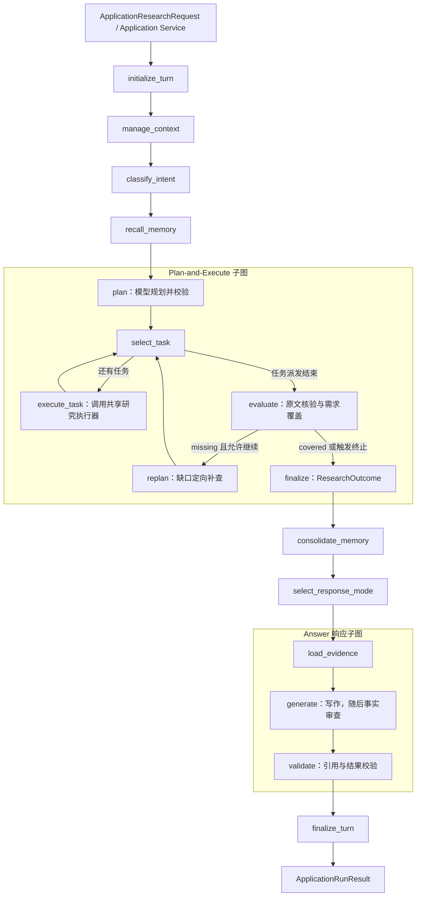
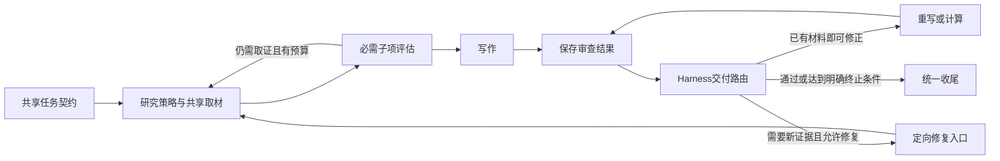

# 一道问题在当前 Harness 中的完整执行链与修改方案

本文依据 2026-11-12 工作区代码，以及北京旅游题重跑的真实模型返回、只读 SQLite checkpoint 和工具执行账本。用途是解释现状和形成修改方案；没有修改生产逻辑，也没有追加付费模型或搜索测试。

## 阅读结论

当前项目已经具备 Harness 的主要运行基础：会话状态图、三种策略、共享取材子图、模型与工具网关、预算、证据原文与引用坐标、检查点、事件和调用追踪。

本次失败发生在这些基础设施之上的数据交接和完成控制：规划提示字段校验失败扩大成整个分工失效；评估的缺口和 covered 状态相互矛盾；补查只消费 covered 状态推导出的缺口；审查结果没有进入可执行状态，也没有审查后的研究回路。

因此需要修改 Harness 里的契约、状态和路由，配合取材优化。增加搜索服务或提高自由循环步数，都不能单独修复这条链路。

## 一、当前架构到底有哪些层

| 层 | 当前职责 | 主要实现 | 本例情况 |
|---|---|---|---|
| 应用入口 | 校验 run/thread 身份，初始化或恢复会话，提取统一结果 | `application/research.py`、`application/agent_adapter.py` | 使用本地装配，直接调用同一 Application Service，未经过 HTTP/前端 |
| Session Harness | 上下文、意图、记忆、研究策略分发、响应分发、最终状态 | `harness/graph.py` | 新会话，明确传入 plan_execute；记忆关闭 |
| 策略编排 | 分工、任务顺序/并行、评估、补查和研究终止 | `strategies/plan_execute/*` 等 | 初始分工退化，一轮重规划，再提前结束 |
| 共享研究执行器 | 搜索、选源、抓取、读取原文、返回取材结果 | `harness/batch_research.py`、`batch_collection.py` | 真正执行了 3 个取材分支 |
| 网关与持久化 | 模型/工具准入、预算、超时、重试、授权、账本、证据库和 checkpoint | `model_budget.py`、`model_gateway.py`、`tools/gateway.py`、`persistence/*` | 保存了足以复盘的数据，未触及本轮模型总预算 |
| 交付子图 | 加载合格证据、写作、事实审查、引用校验 | `responses/graph.py`、`fact_review.py` | 审查识别缺口，交付 partial |

这些不是“6 个互相聊天的 Agent”。部分节点调用模型，部分节点是确定性的状态更新或工具调度。

还存在可选 SDK 自由循环 `harness/agent_executor.py` / `harness/loop.py`，但生产装配 `application/assembly.py:310` 使用的是批量研究子图。本例没有进入自由循环，因此其迭代次数、completion nudge 等参数不能直接解释或修复本次失败。

## 二、当前真实拓扑



图中研究评估有返回补查的边；回答审查后没有返回研究的边。意图识别和研究模式选择也应区分：本例 mode 是请求指定的 plan_execute，未发生“模型比较三种策略后自动选出最优策略”。

共享研究分支当前路径为：

```text
ResearchTopicInput
  → search：程序发起 Tavily 查询
  → select_sources：模型选择候选与需求读取词
  → fetch：程序抓取，已有授权原文可复用
  → read：程序调用 read_evidence 并记录原文锚点
  → finalize：返回 ResearchTopicOutcome
```

代码也保留 synthesize 节点，但本例 v3 分支成功读到原文后，`batch_research.py:49` 将取材阶段标记完成，直接交给父层评估，没有再进行一次分支总结。这能减少重复总结和成本，前提是父层覆盖判断可靠。文档中简单的“search→fetch→read→synthesize”不能当作本例实际发生的完整路径。

## 三、状态、上下文和原文怎样传递

| 数据 | 放在哪里 | 生命周期和用途 |
|---|---|---|
| 原始问题、模式、run_id、研究/响应结果 | `HarnessState.turn` | 一轮对话的权威执行状态 |
| 历史消息、摘要、证据 ID、历史缺口 | `HarnessState.conversation` | 多轮会话可恢复状态 |
| requirements、queries、brief、coverage、findings、replan_count | `PlanExecuteState` | 策略内调度和评估状态；当前只将部分字段投影进 ResearchOutcome |
| 候选 URL、选源结果、工具消息、read_anchors | `BatchResearchState` | 每个取材分支的可恢复状态 |
| 网关、存储、时钟、用户/工作区、功能配置 | `HarnessContext` | 注入运行依赖，不能当作全部执行进度的持久化替代品 |
| 网页正文、版本、哈希、抓取时间 | Evidence Store | 原文独立保存，主要通过 ID 在图之间流转 |
| 当前模型可见片段和 p/g 短编号 | 临时模型输入视图 | 由原文和实际读锚点构造；短编号只在该次调用有效 |
| 模型次数和输入 Token 已用额度 | `RunBudgetModelGateway` + model_run_budgets | 同一 run 共享和恢复，不能靠新建子任务重置额度 |

原文坐标、哈希、来源授权可以验证“引用确实来自读过的这段文字”；它们不能确定这段文字回答了用户的所有子问题。后者仍需覆盖和语义判断。

## 四、真实北京题：逐步发生了什么

运行 ID：`compare-8d4e717b0e33`。问题为首次赴京、非节假日、3 天 2 晚、人均 2000 元、不含往返大交通、公共交通为主，要求路线、美食、预算和预约注意事项。

### 0. 应用与会话初始化：未发现本例故障

`ApplicationResearchRequest` 包含 question、run_id、thread_id、mode。`ResearchApplicationService.invoke` 验证配置 thread_id 与请求一致，再创建新会话或从同 run 的未完成 checkpoint 恢复。

本例使用新 thread 和本地 SQLite；关闭长期记忆用于隔离测试。manage_context 没有需要压缩的历史；recall/consolidate 节点没有产生模型调用。因此，没有证据把本轮问题归因于长对话压缩或记忆污染。

对应代码：`application/research.py:66`、`harness/graph.py:140`。

### 1. plan：第一个确定性故障

planner 实际返回了 3 个 queries、6 个事实需求、任务分工和输出标准。输出标准包括分项预算、单价数量假设、合计不超过 2000 元、合理路线等。

但 research_brief.assumptions 有 5 项，`planning.py:33` 上限是 4。`parse_research_brief` 校验失败返回 None，继而 `seal_initial_plan` 将其视为整个计划 degraded：

```text
原来：3 个查询 + 有效 query_targets + task_briefs
实际：1 个查询 = 整段原始问题
      research_brief = None
      task_briefs = {}
      decomposition_degraded = True
```

原始用户问题仍保留。丢掉的是可执行分工和结构化输出标准，模型后续必须重新从原始问题理解这些要求。

这是已离线复现的因果关系：只在真实 payload 副本中将假设改为 4 项，其他字段不变，真实 seal 函数恢复为 3 个任务。该实验用于定位触发字段，不建议生产逻辑直接静默丢掉第五条假设。

**修改：**拆开需求/任务映射等执行核心校验与 brief 等提示字段校验；允许局部有界修复，保留有效分工和输出标准。失败诊断保存字段路径及处置动作。不能将整体 schema 放宽到任意内容，也不能绕过任务映射和权限验证。

修改入口：`strategies/planning.py:59`、`strategies/evidence_evaluation.py:918`。

### 2. execute_task / search：宽泛搜索导致候选偏离

初始分支没有 task search_queries，程序用整段旅游问题发起一次 `search_web(limit=8)`。general 路径未指定 advanced，落到 basic。

8 个候选包含港台旅游指南、费用游记、2017 年航空 PDF、知乎、YouTube 等。它们可以提供游览灵感，但整体不足以支撑当前预约规则与人民币分项预算。

这里 Tavily 返回的是候选线索，项目没有直接把搜索摘要当成已验证原文。适配层仍把每条摘要截为 500 字符；未向提供商传入地区/语言偏好。上述设置会影响候选与选源，尚没有对照实验量化各自贡献。

**修改：**先恢复有效任务拆分，按缺口生成短查询；政策事实、交通、住宿价格分别选择适合来源。对高价值缺口按需升级搜索深度，传递地区/语言意图和来源提示。保留摘要中的适用范围和必要元数据。不能通过开启全文返回就把搜索缓存正文自动当作已验证证据。

修改入口：`harness/batch_collection.py:142`、`tools/adapters.py:28` 和 `:127`、`tools/search/tavily.py:76`。

### 3. select_sources / fetch：能选源、能替补，但能力与候选不匹配

第一次选源模型选了 c2、c6、c3、c5 四个页面。目标为 3 个成功来源；实际尝试 4 个 URL，成功 2 个，另外 2 个失败：

- Trip.com：insufficient_content，提取正文未达到门槛。
- 南航 PDF：HTTP 阶段“只支持 text/html 页面”，浏览器兜底仍失败。

成功留下的是 8 日费用游记和 5 天 4 夜攻略。fetch_sources 已有“从剩余候选替补”的循环，不能说完全没有失败恢复。但 select_sources 已把 candidate_urls 限定为所选集合，四个用完后不会自动回到原始 8 个候选，更不会新搜。

这里还暴露出工具能力交接问题：搜索发现了 PDF，选源选择了 PDF，但正文抓取器按 HTML 处理。浏览器兜底不能自动变成 PDF 解析器。

**修改：**保留已排序候选和候补集合；给选源阶段声明可读取的内容类型。遇到不支持的 PDF 时，选择可读替代源，或经预算授权走单独 PDF reader；抓取失败按类别替补。相关候选耗尽时，把 acquisition gap 交给父层，而不是把任意两篇成功抓取当作足够。

修改入口：`harness/source_selection.py:134`、`harness/batch_collection.py:248`、`tools/scraper/fetcher.py`。保留已有 URL 安全和原文准入边界。

### 4. read / 原文交接：实际读到了材料，但“读过”还不等于“满足任务”

初始分支对 2 个来源分别按 6 个需求读原文，共 12 条逻辑读取请求；交通补查再读 3 条，住宿补查再读 2 条，共 17 条。当前每次请求 limit=3000，并按需求词选段。

读取结果形成带 evidence_id、版本、哈希和坐标的 read_anchors。v3 分支随后结束取材，将原文交给全局评估。全局视图还受来源数、阅读组、引用单元和 Token 限制；当前一般路径每来源选择上限会随需求数在 3000–6000 字符之间变化，并非所有地方固定 3000。

本例有 read_anchor_omitted 诊断。尚未逐字段证实某个关键价格恰好在省略窗口中，因此不能直接断言所有漏答来自截断。

**修改：**保留现有锚点与完整阅读组机制，补充 slot → 来源 → 读到范围 → 评估可见范围 → 写作可见范围的映射。区分“尚未读到”“当前窗口未展示”“读到但不适用”“原文没给出”。前两类优先补读，不能统一解释为全网无资料。按来源与需求匹配度安排读取，减少对每个来源轮流读全部需求的浪费。

### 5. evaluate：第一轮已经误判部分覆盖，并丢失缺口

第一次模型输出的 unresolved_gaps 有 6 条，覆盖景点价格/开放时间、交通、人民币住宿、美食价格、耗时、天气防骗。

但是同一次输出把 r1、r4、r5、r6 标成 covered，只把 r2、r3 标 missing。程序最终用于路由的缺口由 coverage.items 中非 covered 的项重建，因此真实状态只留下交通、住宿 2 条。

这不是模型没有发现任何缺口。模型输出的两个表示发生矛盾，宿主选择 coverage 作为路由依据，但没有解决矛盾。`normalize_coverage` 校验 finding ID 和支持引用合法，无法证明一个复合需求的所有必要成分均满足。

**修改：**为必要子项保存结构化状态，父级覆盖由宿主聚合；缺口从同一结构派生。自由文本解释和另一个独立缺口列表不能各自决定完成。在输入或输出自相矛盾时，不能直接 complete，应进行一次定向纠正或保守保留相关必需缺口。

“存在有效引用”只能作为覆盖的必要条件。价格是否是人民币、是否是每间每晚、是否适用经济型酒店，仍需语义/条件核验和明确计算。不要把任意候选景点、所有小吃和附加提醒都变成新的必答槽位。

修改入口：`domain/coverage.py`、`strategies/evidence_evaluation.py:387`、`:848`，以及三种策略的模型输出契约。

### 6. replan：机制确实工作，但只能补查留下来的缺口

程序进入一次重规划，模型生成了两条查询：

```text
北京地铁票价 起步价 里程计价 公交票价 2025
北京 经济型酒店 双人标间 每晚价格 人民币 2025
```

这说明“研究阶段完全没有重规划”不符合实际。问题是上一阶段只传下 r2/r3，其他已误标 covered 的缺口不再可补查。日期又从当前 2026 年偏到 2025 年。

交通分支抓取 3 个来源；住宿分支尝试 3 个，成功 2 个，天巡内容不足。最终共保存 7 个原文来源。酒店命中 KAYAK 香港页和 Booking 区域列表；全局评估最终排除 Booking 和百度百科，保留 5 个来源供回答。

**修改：**修复上游缺口后，重规划使用稳定 requirement/slot ID、明确失败类型和当前日期；优先补读或补条件匹配的证据。普通政策和预算参考不应机械附加年份，需按时间语义决定。保持现有同一查询去重、补查轮数与无进展退出。

修改入口：`plan_execute/nodes.py:255`、`evidence_evaluation.py:164`。当前 PE 的 supplement 调用没有开启 Workflow 的 allow_reread 能力，扩展前应明确所有策略的恢复入口和责任。

### 7. evaluate / finalize：有预算、有缺项，仍提前结束

第二次评估把 6 项全部标 covered，解释仍写着“长城具体票价未给出”“公交票价及枢纽到景点耗时费用缺失”“各景点间单程耗时未具体给出”等。

`coverage_complete` 返回 True，`build_route_after_evaluate` 直接 finalize。重规划次数是 1，上限是 2，没有用完；整个运行最后只使用 9/20 次模型调用、66,631/100,000 输入 Token。

所以程序停止的直接条件是 coverage_complete，而不是预算或死循环。ResearchOutcome 为 completed，research_sufficiency 为 sufficient，事实覆盖判据已失真。

**修改：**与步骤 5 同一处修复，避免添加第二套“最终 coverage”。完成必须满足用户必需项已被支持、被允许估算或可用已知输入计算；证据不够则继续有界补查；没有可执行路径则诚实交付部分结果。

修改入口：`evidence_evaluation.py:531`、`plan_execute/nodes.py:236` 和 `:311`、`application/research.py:193`。

### 8. generate：正确性、估算和写作交付缺少共同契约

Session 随后执行 consolidate_memory（本例无操作）、选择 answer 模式，加载 eligible 原文，组装支持片段，调用 writer。writer 使用的仍是原始问题、事实需求、findings 和可见原文，不是一个贯穿全流程、保留全部预算交付标准的统一契约。

此外，当前 `domain/execution.py:127` 的 ResearchOutcome 本身不含 research_brief/answer_criteria，`ResponseInput` 也没有独立交付标准字段。所以，即使某轮 brief 合法，结构化 answer_criteria 也没有作为独立契约完整传给响应层；writer 仍可从原始问题识别这些要求，但缺少共享、可校验的交付清单。

本例材料包含港币酒店统计、新台币旅行花费。它们不是完全无价值，但不能不说明条件就直接充当北京经济型酒店的人民币双人间价格。用户允许估算，系统应说明假设、参考依据和计算方式，而不是将“无法确认精确报价”扩展成“无法形成任何分项预算”。

**修改：**区分 policy_fact、reference_range、explicit_assumption、derived_value、recommendation 等任务数据类型；关键事实保留引用。对价格保留币种、每房/每人、每晚/全程、人数和晚数。预算合计由确定性计算校验。输出标准在需求契约内保留，不能随 brief 丢失，也不能只存在某一阶段的提示词里。

修改入口：`domain/response.py:72`、`domain/execution.py`、`responses/evidence.py`、`responses/writing.py`。这是契约设计调整，不能靠一条旅游专用 prompt 硬编码解决。

### 9. review：能同源纠错，但新增证据缺口没有出口

`responses/graph.py` 的 generate 内先写作，再调用 fact_review。reviewer 可以用同批原文修正和补齐内容；已具备结构/引用纠正和一次瞬时故障恢复。真实最后一次调用返回 6 条 unanswered_points。

代码保留修订后的 content，将缺口压成 `grounding_issue=answer_review_incomplete`，再发出 `response.fact_review.completed` 事件。ResponseState 和 ResponseOutcome 没有保存这份结构化审查结果，最终 ApplicationRunResult 也主要返回研究侧 gaps 与一个回答失败原因。

因此，复盘可以从事件和原始 trace 找回这些缺口，但运行图不能直接把它们作为恢复输入继续执行。回答图仍是 load→generate→validate→END。

审查本身也可能误判或增加多余要求。不能把 reviewer 的每条意见直接当作新用户任务；应先映射回已封存的必需项和实际所选路线。

**修改：**保存 typed ReviewResult，包含 issue_type、requirement/slot ID、evidence ID、处理建议和剩余缺口。将审查拆成可恢复节点或显式保存其结果；对同源重写、确定性计算、补读、补搜分别路由。修复结果重新经过同一完成判据，不能独立设置另一个“通过”标记。

修改入口：`responses/fact_review.py`、`responses/state.py`、`domain/response.py:91`、`responses/graph.py:597`。

### 10. validate / finalize_turn：partial 是最后的可见症状

validate 校验引用编号等结构；`harness/graph.py:368` 检查研究是否可用、回答 partial_reason 是否为空。回答仍有 answer_review_incomplete，因此最终 status=partial。

此处如实暴露了缺项。修改这个状态判断、隐藏 partial 或关闭事实审查，不能让公交、长城和人民币预算证据自动出现。

**修改：**在 finalize_turn 前增加交付路由，让已经保存的结构化审查结果有机会触发受控修复。只有通过、用户允许的部分交付或达到真实终止条件，才进入最终收尾。

## 五、实际消耗落在哪些步骤

下表来自真实模型 trace 的 usage 和调用起止时间；时间是各模型调用耗时，不包含所有网页网络、存储和调度成本，不能当作完整阶段耗时。

| 次序 | 模型职责 | 输入 Token | 输出 Token | 调用耗时 |
|---:|---|---:|---:|---:|
| 1 | 初始规划 | 2,550 | 1,614 | 11.794 秒 |
| 2 | 初始选源与读取词 | 2,802 | 211 | 1.808 秒 |
| 3 | 第一次原文评估 | 8,686 | 1,575 | 9.988 秒 |
| 4 | 缺口重规划 | 3,157 | 67 | 1.264 秒 |
| 5 | 交通选源 | 2,564 | 56 | 1.400 秒 |
| 6 | 住宿选源 | 2,851 | 49 | 1.334 秒 |
| 7 | 第二次原文评估 | 15,652 | 1,916 | 11.938 秒 |
| 8 | 写作 | 13,778 | 1,968 | 12.343 秒 |
| 9 | 最终审查与修订 | 14,591 | 2,816 | 13.652 秒 |
| 合计 | 9 次调用 | 66,631 | 10,272 | 端到端 117.657 秒 |

两次评估、写作和审查合计占总 Token 约 79.3%。优化成本时要分析哪些原文/任务说明被反复传递，而非只增加搜索源或删除检查步骤。当前角色聚合将 responder 计入 writer，所以上表特意把 draft/review 分开。

工具账本共 30 条逻辑执行记录：search_web 3、fetch_page 10、read_evidence 17；其中 3 条抓取失败。它们不是底层 HTTP/浏览器请求或重试次数。7 个原文被保存，5 个来源最终 eligible。executed_steps=33 是程序统计的执行步数，与 9 次模型调用、30 条工具记录不是同一指标。

首次旅游运行另有两次 researcher 模型连接失败，最终 model_error；它与本次正常完成 9 次调用后仍漏答的链路应分开归因。现有项目有有界重试，具体角色接入一致性仍需单独验证。

## 六、结合 Harness，建议怎样修改

### 推荐路径：保留现有分层，统一契约，再闭环

可比较三种方案：

| 方案 | 改动与收益 | 局限 |
|---|---|---|
| 只修 brief 整体降级 | 小改动，恢复大部分有效分工 | 错误 coverage 和审查无回路仍存在 |
| 统一契约 + 局部降级 + 有界交付修复（推荐） | 使用已有网关、证据和 checkpoint，修复已确认的完整失败链 | 涉及跨图 DTO 和 checkpoint 兼容，需要分步验证 |
| 直接替换框架/改成自由多 Agent | 可改变调度方式，支持更开放探索 | 迁移成本高；不会自动解决 covered 语义、估算条件和审查反馈问题 |

建议新增/扩展的职责如下，名称是设计建议，并非已存在实现：

1. **任务契约。** 用户原始问题与硬约束不可变；列出必需交付项、允许假设、可估算项、选择条件、输出标准。保留顶层需求分组，对必要事实增加有界子项，避免简单把现有所有 `r[1-6]` 限制改成无限列表。
2. **统一缺口结构。** 绑定稳定 slot ID、缺口类别和恢复动作。已有证据未写入、窗口未展示、证据不适用、缺计算输入、确实缺来源分别处理。顶层 covered 与 unresolved_gaps 从这份状态派生。
3. **持久审查结果。** ReviewResult 进入 State/Outcome，事件仅作为观察副本。保存版本、轮次和相关证据，支持崩溃后从明确边界恢复。
4. **Session 负责交付修复路由。** 三种研究策略继续负责研究调度；共享执行器继续负责取材；网关继续管授权与额度。不要让 reviewer 自行越过 ToolGateway 搜索，也不要把所有恢复逻辑塞进模型提示词。
5. **恢复入口继承现有成果。** 用原 run_id、同一预算和已有契约/证据定向补查；不能将“修复”变成新 run 重置预算、重新 plan 丢掉状态。需要定义继承已有 ResearchOutcome/契约的恢复请求，或共享的 targeted-repair 子图。
6. **第一版最多一轮交付修复。** 研究内部原有补查上限与外层交付修复同时约束；记录总次数、剩余额度、截止时间、重复动作和必需槽位变化。预算不足时允许受限交付，不保证每次都能在剩余额度内修复。



这是有上限的循环图；重写也计入总修复额度，不能通过重写边形成无限循环。审查不能新增用户未要求的必需槽位。

内存整合和会话合并目前在研究后、回答前。如果加入外层修复，需要避免每次返回研究后重复写记忆、重复追加 findings；建议在受控交付阶段后集中合并一次，或按稳定标识幂等合并。部分答案中的已支持事实仍可按原有准入保存，不能把“整体 partial”简单等同于“每个事实都不可用”。本例记忆关闭，未观察到实际记忆污染。

### 修改点和验收应成对出现

| 优先级 | 修改模块 | 必须通过的验收 |
|---|---|---|
| P0 | planning / seal_initial_plan | 5 条假设不再丢弃有效任务；映射无效时仍正确拒绝/回退 |
| P0 | coverage DTO / evaluator / supplement | 原始模型报告 6 条缺口、status 却仅 2 条 missing 的矛盾得到明确处理；必需项不再丢失 |
| P0 | ResponseState / ResponseOutcome / Harness route | reviewer 的必需缺口可持久恢复，并触发一次定向修复；同一 run 不重置预算 |
| P1 | source_selection / batch_collection / fetcher | PDF 能力不匹配时明确跳过或由适合 reader 处理；候选失败能有界替补 |
| P1 | task / price / response contract | 币种、每房/每人、晚数不混用；估算明确标注并核对总价 |
| P1 | model_recovery /各角色入口 | 一次 transient 可恢复；持续失败按预算停止，usage 缺失保留未知 |
| P1 | events / result projection / docs | 完成、部分交付、错误、窗口省略分别可定位；界面和返回结果能展示真正待补项 |

跨图 DTO 修改需同步 planner、评估器、补查、writer、reviewer、State、Outcome、结果投影和 checkpoint serializer。当前证据契约为 v3；是否升级版本需在实现设计时决定，旧完成记录应可读，旧运行中状态不能无声按不兼容契约继续。

当前仓库文档与代码已有差异：Workflow 图已包含 recover/reread/prepare_search，不能继续称为绝不补查的固定路径；一般 v3 分支也不必经过 synthesize。本报告对本例按代码和 checkpoint 说明，其他策略应各自回归，不能从 PE 一次运行推出其他模式的成功率。

## 七、验证顺序与边界

先使用真实 payload 离线验证每个边界，再运行同一题观察链路是否改变，最后扩展到不同类型的小型任务集并重复测试。不要同时更换模型、搜索源、预算和架构，否则无法判断改进来自哪里。

核心质量指标是必需交付项完成和关键事实支持；执行 completed、covered 数量、来源数、引用数量分别作为过程指标，不能代替用户可用性。记录修复前后调用、Token、搜索额度、端到端耗时、重复检索和故障恢复；没有实测前不写提升百分比。

可复核材料：

- `docs/architecture/2026-11-12-incomplete-answer-root-cause.md`：根因总表。
- `.local-artifacts/beijing-comparison-20261111/project-attempt-002/project-result.json`：真实结果。
- 同目录 `project-state/harness_checkpoints.db`：原始持久状态。
- `.local-artifacts/beijing-comparison-20261111/diagnosis/llm-trace.json`：9 次模型原始输入输出。
- 同目录 `replay.py` / `replay-result.json`：初始退化和覆盖误判回放。
- 同目录 `export_harness_walkthrough.py` / `harness-walkthrough.json`：本次只读导出，包含会话节点、研究状态变化、分支、工具统计、逐次 Token 和两份缺口表示的差异。

导出脚本断言了 9 次 usage 合计与结果一致，且第一次模型缺口为 6 条、宿主路由缺口为 2 条。没有据此宣称建议方案已经实现或证明质量提升。
