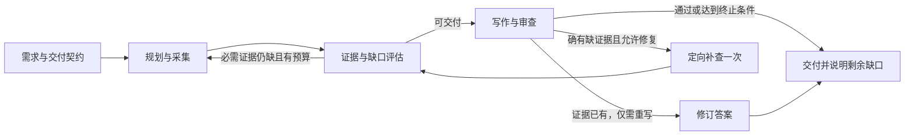

# 回答不完整：真实运行根因与修复建议

日期：2026-11-12。范围：定位与方案，没有修改生产逻辑。

## 结论和证据边界

北京 3 天 2 晚、人均 2000 元的问题，第二次运行暴露了完整的失败链：

> 规划附属字段校验失败 → 3 个任务整体退化为 1 个宽泛搜索 → 证据不足 → 评估器仍把有缺项的需求标为 covered → 提前结束研究 → 最终审查发现缺项 → 没有补查回路 → partial。

这是通过真实模型返回、只读 checkpoint 和真实函数离线回放确认的链路。它说明当前实现存在可重复触发的缺陷；两次旅游测试不足以推算所有问题的失败率。也没有证据证明“换更强模型”或“扩大预算”就能解决这些控制流程问题。

| 运行 | 耗时 | 模型调用尝试 | Token | 最终状态 |
|---|---:|---:|---:|---|
| 北京题第一次 | 159.656 秒 | 8，含 2 次无 usage 返回 | 已观测 56,301，完整总量未知 | partial / model_error |
| 北京题重跑 | 117.657 秒 | 9，全部有 usage | 输入 66,631，输出 10,272，合计 76,903 | partial / answer_review_incomplete |

重跑配置为最多 20 次调用、100,000 输入 Token。研究终态为 completed，research_sufficiency 为 sufficient，最终回答仍 partial。此轮首先应修正完成判据和反馈流程，不能归因为预算耗尽。

## 1. 已确认：一个附属字段错误丢掉整个有效分工（P0）

真实 planner 返回了 3 个 queries、有效 query_targets 和任务简报，但 research_brief.assumptions 有 5 项。

- `backend/src/deeptrace/strategies/planning.py:33` 将 assumptions 限制为最多 4 项。
- `parse_research_brief` 在 ValidationError 时返回 None。
- `backend/src/deeptrace/strategies/evidence_evaluation.py:918` 的 `seal_initial_plan` 把简报无效纳入整体 degraded。
- 只要 degraded，就用原始问题替换全部 queries，并清空 task_briefs。

checkpoint 中确实出现 `initial_research_brief_degraded`、`decomposition_degraded=True`、`research_brief=None` 和唯一任务“整段原始问题”。原始用户问题仍被保留，没有被删除，但结构化调研指引和分项验收标准丢失。

离线回放结果：原始 payload 得到 1 个退化任务；只在副本里把 assumptions 从 5 项改成 4 项，其他内容不变，得到 3 个任务、degraded=False。这确认了具体触发字段。这个反事实实验不代表生产环境应该静默截断假设，也不代表恢复这 3 个任务就一定答好：原计划仍把住宿、餐饮、交通塞进同一分支，检索词对餐饮覆盖不足。

**解决方案：**将需求、任务映射、检索建议、附属简报分层校验。安全有效的任务映射和 queries 应保留；附属字段错误应局部修复或回退。对无法验证的任务权限/需求映射仍严格拒绝，原始约束持续保留。为模型提供与运行 schema 一致的结构约束，必要时进行一次有预算的定向修复，并记录字段路径、修复动作和损失范围。

验收：增加“5 条假设、其他内容有效”的回归样例；不得整体退化为原问题单搜；不得丢预算、交通方式等用户约束。另测任务映射真正无效时仍安全回退。

## 2. 已确认：需求含多个子项，只要部分有证据也可能判完成（P0）

真实最终评估有 6 项需求，全部标为 covered，但解释包括：

> “地铁里程票价、支付方式、线路衔接有证据；公交票价及枢纽到景点耗时费用缺失。”

其他解释也明确承认长城具体票价、部分美食价格、景点间单程耗时缺失。

`backend/src/deeptrace/strategies/evidence_evaluation.py:387` 的 `normalize_coverage` 检查引用的 finding ID 是否有效、有 supports，但不能保证一项复合需求内每个必需子项均已满足。真实评估结果通过该函数回放后，6 项仍全部 covered。

后续 `coverage_complete` 依据状态全部 covered 返回 True；`plan_execute/nodes.py:236` 据此 finalize。事实覆盖缺口没有进入补查列表。最终 outcome 仍有 `read_anchor_omitted` 诊断项，因此不能说整个 unresolved_gaps 字段完全为空。

**解决方案：**先定义用户真正需要的交付项，再拆出必要事实槽位。每个槽位分别声明 supported / derived / estimated / missing，以及依据、单位和适用条件；父需求必须由必需槽位聚合，不能仅依赖模型给出的顶层 covered。补查直接消费结构化 missing 项。不要通过扫描解释中的“缺失”二字做正式逻辑，也不要把所有候选景点、所有小吃和所有可选提醒都扩大成必答项。

验收：已有地铁信息、缺必需公交信息时，不能整体 covered；有材料但未形成预算时，应区分“写作待完成”和“证据待补查”；可选景点缺价不应阻塞已选路线交付。

## 3. 已确认：最终审查能发现问题，无法推动修复（P0）

真实最后一次 reviewer 返回了 6 条 unanswered_points，包含公交票价、长城交通/票价、经济型酒店价格等缺项。

- `backend/src/deeptrace/responses/graph.py:623` 将 unanswered_points 转成 `answer_review_incomplete`。
- 同文件 `build_response_graph` 是 load_evidence → generate（含审查）→ validate → END。
- `backend/src/deeptrace/harness/graph.py:432` 将回答节点接到 finalize_turn，没有返回研究节点的边。

因此当前审查是交付前的检查关口，检查失败就带着 partial 输出。已有审查并不等于已有纠错闭环。

**解决方案：**研究、写作、审查共享同一个交付契约。审查输出应映射到已有 requirement/slot ID，并区分：已有证据未写入、需要计算、确实缺证据、引用无效。已有证据只重写；需要证据才定向补查。第一版最多增加一轮修复，所有调用仍占同一任务预算，并受超时、无进展和重复查询约束。审查提出的额外要求先核对原始任务，不能无限扩展范围。

建议流程：

验收：本例所示“研究称完成、审查有必需缺口”不能直接静默终止；补查成功后重新形成答案；没有进展或达到上限时可终止为 partial，并记录真实剩余缺口。不能仅删除 partial 标记来提高完成率。

## 4. 已确认现象、需进一步设计：估算类任务缺少统一语义（P1）

用户明确允许普通非节假日估价。规划扩展出很多景点、每种食物价格、枢纽耗时、天气/防骗等细目；预算合计等输出标准保存在 brief 中，brief 失败后这些结构化标准也未保留。当前 6 个事实需求没有单独表达“形成分项预算并核对 2000 元上限”这个交付动作，虽然原始问题始终可见。

本次采集还出现了以港币显示的酒店页面、以台币记账的游记。它们可以提供部分背景信息，但不能直接充当北京普通经济型双人间的人民币单价。重跑 `source_policy` 实际为 general，不能归因为系统强制只允许官方来源。写作/审查也并非绝对禁止推断；问题在于“可估算内容、明确事实、单位换算和用户假设”没有形成贯穿全流程的一致约定。

**解决方案：**区分政策事实、参考价格区间、明确标注的估算、计算结果和推荐取舍。人民币/每间每晚/人数/晚数进入价格证据字段；先找符合条件的来源，再按明确假设计算预算。住宿可公开采用“2 人拼住双人房”的假设并说明；不将该假设写成用户已明确要求。预算合计与上限由确定性计算核验。关键预约规则仍需合适来源，估价不能被包装成已确认报价。

验收：普通旅游估价能够输出区间、数量假设和合计；港币/台币材料不能未经处理直接填入人民币预算；可选候选方案不能使用户的 3 天行程越来越庞大。

## 5. 已确认：采集窄且失败页面替补不足，放大前述问题（P1）

当前 `harness/batch_research.py:31` 默认每分支 source_target=3；`batch_collection.py` 的读取窗口通常为 3000 字符。v3 分支取得可读原文后即可完成，把是否覆盖的判断交给父层。这一分层本身成立，但依赖父层可靠地发现和补齐缺口。

本次规划退化后，首次宽泛搜索主要读到了旅游游记，而非针对价格、预约、住宿分别采集。后续补查集中于地铁和酒店；部分页面抓取失败或内容不足，酒店补查又命中币种/档次不匹配的页面。重规划还生成了 2025 年检索词，与当前 2026 年时间上下文不一致。以上由采集记录与模型 trace 可见。

**解决方案：**先修复分工和 coverage，再按缺口配置搜索意图、地区、币种、来源类型和时间。页面失败或不满足需求时，使用共享预算内的少量替补；已覆盖项目不重复检索。增加一次小规模、缺口驱动的搜索/阅读迭代，而非统一把每分支来源数大幅放大。时间应按问题需要使用当前日期或不限定年份，不能随意补去年份。

存在 `read_anchor_omitted` 诊断，但尚未逐个价格字段证明“被裁剪的材料正是导致漏答的材料”。因此，阅读截断只能列为需验证项，不能当作本轮已证实的主要根因。

## 6. 已确认：首次运行有真实模型连接错误（P1，独立处理）

首次 `project-run.log` 两次出现 researcher 角色的 `OpenAIConnectionError`，对应两次没有 usage 的调用尝试，最终为 model_error。不能把没有 usage 的调用记为消耗 0 Token。重跑 9 次调用均正常返回，仍因回答缺项结束，说明网络恢复之外还需要修复上述逻辑。

项目已有 `harness/model_recovery.py` 对 transient 类型进行一次、纳入共享预算的重试，不能说完全没有重试机制。需要核查各角色入口是否一致接入，记录第一次失败/重试/最终失败的关联关系，保留异常类别和已完成进度。只对可恢复错误有界重试，授权错误、无效请求和预算耗尽不应盲目重试。

验收：注入一次瞬时故障时能恢复且只新增一次已记账调用；持续失败按上限终止，保留已有材料；缺失 usage 继续保持未知。

## 建议修复次序与验证方式

1. **先做局部确定性修复：**规划字段局部降级；保留输出标准；用真实 5 条 assumptions payload 回归。无需先重写整个框架。
2. **统一交付契约和覆盖语义：**拆分必需与可选项，表示事实、估算和计算，解决“解释说缺、状态说全”的问题。这是后续闭环的基础。
3. **增加有界修复回路：**基于共享契约判断重写或补查；先限定一轮，保持预算/超时/无进展控制。
4. **针对采集与恢复做优化：**有效来源替补、单位/币种/日期约束、角色级瞬时错误恢复；根据实测调整预算。
5. **再评估是否做架构重构：**先在这些机制上建立可量化基线，再决定向成熟开源架构迁移的范围。迁移框架本身不能替代上述语义和恢复机制。

方案取舍：单独修好 planner，成本小但无法消除错误完成；直接加外层重试循环，容易把错误覆盖和范围膨胀放大为重复检索；推荐先修局部降级和契约，再接有界闭环。立即整体重写的验证成本最高，目前证据尚不要求从零重建。

验证分两层：先离线回放本次真实 payload、错误 covered、审查缺口、币种不匹配等边界，再做同题真实重跑。之后使用不同任务类型的小型固定样本，固定模型、日期、预算与记忆隔离设置，每题重复运行，避免将一次成功解释为稳定改善。

指标应分别报告：执行正常结束率、用户必需交付项完成率、有证据支持的关键事实比例、故障恢复成功率、重复搜索比例、模型/工具调用、输入/输出 Token、端到端耗时及预算触顶率。Token 缺失需单列；同时报告平均值和耗时分位数。不要将终态 completed 数量单独作为质量指标。

## 复核材料

- 原始比较报告：`.local-artifacts/beijing-comparison-20261111/comparison.md`
- 重跑结果：`.local-artifacts/beijing-comparison-20261111/project-attempt-002/project-result.json`
- 只读 checkpoint：`.local-artifacts/beijing-comparison-20261111/project-attempt-002/project-state/harness_checkpoints.db`
- 模型调用链：`.local-artifacts/beijing-comparison-20261111/diagnosis/llm-trace.json`（9 次调用，含原始规划和最终审查）
- 离线复现脚本：`.local-artifacts/beijing-comparison-20261111/diagnosis/replay.py`
- 复现结果：`.local-artifacts/beijing-comparison-20261111/diagnosis/replay-result.json`
- 首次连接错误：`.local-artifacts/beijing-comparison-20261111/project-run.log`

本次只增加诊断材料、回放脚本和本文；未修改生产代码，也没有宣称修复已提高成功率。规划与评估函数被 Workflow、Plan-and-Execute、Multi-Agent 共用，缺陷具有跨策略风险；本报告直接验证的是 Plan-and-Execute 运行，其他策略需分别回归。
