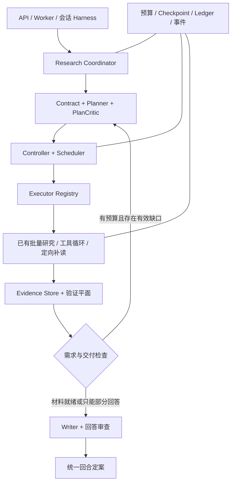

# Contract 驱动研究运行时：架构评审与重构方案

日期：2026-11-14。状态：用户已确认简化方向并授权实施。

## 实施收敛（优先于下文的早期设计）

统一内核围绕规划、执行、验证、有限补查组织。Contract/Critic/Controller/Scheduler 保持为内核内部类型与函数，不建设独立服务。复用现有 LangGraph 持久化的 task pending writes，按任务节点恢复，不新增任务数据库或迁移。已有工具 Ledger 与持久化 RunBudget 继续负责副作用复用及总额度。

本轮只启用已有批量 retrieve 执行能力；未实现的任务执行方式在 dispatch 前拒绝，通用计算与多执行器框架后置。事实义务可跨来源得到支持，综合交付沿用现有 Writer 和事实审查。本轮保持 legacy 默认入口，提供显式 controller 配置用于生产集成验证；真实模型同题质量对比通过后才切默认或删除旧策略。子任务调用上限约束单次任务尝试，总 run 的跨恢复预算仍由持久化 Gateway 约束。

任务结果进入图状态，每个执行分支单独落盘；补查生成同 plan_id 的新 revision，只增派未覆盖目标，保留计划历史。取消继续传播，普通分支错误隔离保存。用现有范围审查与补读/补查协议取代原先的固定缺口查询循环。

本文以当前工作区代码为依据，补充 `target-architecture.md`。原文中的流程与待办作为设计资料评估，不视为自动执行指令。工作区已有大量未提交更改，本次迁移必须保留这些更改，不从 HEAD 覆盖现有实现。

## 1. 结论与方案选择

保留 Contract、Plan、Evidence、Verification 的总体方向，但先补齐运行闭环，再切换入口，最后删除重复策略。模块存在、可序列化、图可编译，都不代表已经具备生产恢复能力。

| 选择 | 收益 | 代价及风险 |
| --- | --- | --- |
| 推荐：渐进统一运行时，以独立配置切换编排器 | 保留 API、历史记录和回退路径，每阶段可验证 | 迁移期间短期保留旧实现 |
| 直接替换三种策略 | 最快减少目录和代码 | 当前恢复、分派和补查能力不足，易出现行为倒退 |
| 只完善新库，保持生产路径 | 改动小 | 继续维护两套控制流，无法完成架构收敛 |

首个交付范围是“生产可用的统一编排内核”，覆盖当前已有研究能力的迁移。暂不新增通用计算沙箱、复杂优化器或独立图数据库。没有实现的执行能力必须在执行前拒绝，不能静默降级为检索。

## 2. 已确认的实现差距

| 位置 | 当前行为 | 调整 |
| --- | --- | --- |
| `application/assembly.py` | 仍注册三个旧策略图 | 内核具备行为等价后，再接入统一运行时 |
| `research/runtime.py::_execute_wave` | 只用 Controller 的并发值，没有消费 `task_modes` | 增加显式执行器注册与分派；区分调度形状和任务执行能力 |
| `research/runtime.py::_execute_task` | 固定 WORKFLOW/caller，只取第一个 query；约束和上下文为空 | 传递用户模式、稳定任务标识、全部查询、约束、上下文和依赖产物 |
| 同上 | 没有使用任务的 `max_pages`，也没有绑定任务调用预算 | 将计划额度落实到调用前的宿主限制，不能只在 Critic 中估算 |
| `research/runtime.py` 补查循环 | 重建 revision=1 的计划；缺口子计划经过适配器后会重新承担全部需求 | 保留版本链和已完成任务，新任务只处理缺口；Critic 按整份修订计划评审 |
| `research/runtime.py::_execute_wave` | gather 任一异常会传播；成功分支未必进入已保存结果 | 隔离普通任务异常，保存成功任务；取消信号继续向上传播 |
| `research/runtime.py` | Scheduler 和计划都保存在单个图节点的局部变量中 | 按任务边界保存状态，恢复时复用已完成产物 |
| `research/runtime.py` | 完成只判断 verification coverage | 同时检查必要任务、阻塞项和回答生成；研究就绪与回合完成分开 |
| `research/critic.py`、`controller.py` | Review 只关联 revision，不能区分同版本的不同计划 | Review 绑定 plan_id、contract revision、规范化内容摘要，分派前复核 |
| `research/contract.py` | frozen 外层仍包含可变 ResearchRequirement；默认预算未从生产预算绑定 | 不可变快照或防御性复制；预算来源统一 |
| `research/evidence_graph.py` | ACCEPTED 基于来源适用性和引用区间等校验；需求关联来自提交的 coverage | 明确结构校验与语义判断的边界，防止循环论证 |
| `tests/research/test_runtime.py` | 仅验证编译成功 | 增加实际调用、失败、补查、恢复、成稿集成测试 |

## 3. 目标边界与依赖

Harness 保留会话、意图、记忆、Writer 路由；Coordinator 只负责单次研究。Scheduler 只处理任务生命周期与依赖；Controller 只在已授权能力中选择执行方式；Executor 不修改全局计划。Verifier 提交质量判断与缺口，Coordinator 决定是否继续。Writer 在研究阶段之外统一执行，避免 DAG 内外重复成稿。

`research` 中的契约、计划、调度和完成规则保持纯领域逻辑。运行编排依赖抽象端口；旧 `strategies` 的规划、取材、评估能力通过适配层复用。先整理依赖，再逐步移动文件，避免以目录搬迁代替架构重构。

## 4. 需求与验证：修正过强假设

“可判定的验收标准”应保留；“每条 requirement 必须由一段原文直接支持”应取消。

区分两类义务：事实义务要求可追溯证据，例如票价与发布日期；交付义务检查回答是否完成比较、计算、约束满足或指定格式。迁移第一阶段复用现有 `ResearchRequirement` 和证据覆盖字段，将交付检查作为独立结果附加，不立即扩大所有 ID 正则与持久化结构。

综合结论必须关联输入 Claim 和推导方式；确定性计算由宿主执行。无法验证的建议需明确表述为建议。最终回答审查检查新增事实、引用和交付约束；不能仅凭 Writer 输入经过过滤就宣称输出不会产生无依据事实。

验证分为：

1. 结构与来源：原文存在、ACTIVE、版本和哈希匹配、区间准确、来源满足政策。
2. 语义支持：原文是否支持 Claim、是否存在冲突、是否支持对应事实义务。模型可给建议，宿主校验其引用与允许的决策结构；必须记录语义判断的依据及不确定性，不能宣称其为确定性事实证明。
3. 交付检查：回答是否满足用户限制、综合目标与格式。

验证结果绑定 contract revision、plan revision 和 evidence snapshot。旧通过项按证据版本保留，本轮未评估项标为 unknown；不能把旧 coverage 冒充新结果。来源变更或失效时，相关通过项必须重新验证。

## 5. 计划、执行与补查

执行器端口接收 TaskExecutionRequest，携带任务、契约快照、依赖结果、允许证据、剩余额度、用户模式和调用身份；返回 TaskExecutionResult，包含任务状态、证据、发现、错误和用量。结果始终关联 run_id、plan_id、revision、task_id、attempt。

首阶段将已有批量研究注册为 retrieve；定向补读作为已有能力接入。loop 必须在工具循环适配与契约测试通过后启用。direct 只适用于无需外部事实取材的已授权任务，不能绕过验证。fanout/dag 是 Scheduler 的调度形状，不另建嵌套 fanout 执行器；历史 ExecutionMode.FANOUT 由边界适配器转换，避免双层并发。

Ready-set 由依赖状态决定，Executor 只接收明确依赖产物与授权证据。结果按计划稳定顺序归并。单任务失败阻断后继，其他独立分支继续。调度并发上限同时考虑配置和当前资源额度。

补查保留同一 plan_id，通过 next_revision 生成父版本和原因；保留已完成任务及产物，新任务使用不冲突的 ID。修订记录描述补读、替换来源或重新查询，只有对应旧证据失效时才使相关通过项失效。缺口无变化、无新增有效证据、轮数耗尽或预算不足时停止。

计划有任务数上限，补查若超过上限应输出 partial 并说明缺口；不能截掉未覆盖需求，也不能通过重置 revision 绕过上限。任务身份跨 revision 复用必须验证任务定义及依赖产物摘要一致。

## 6. 预算、失败和恢复

生产配置及持久化 RunBudget 是唯一实际额度来源；ContractBudget 是该额度的快照，TaskBudget 是子额度。任务分配、重试、规划、评估与补查共同消耗同一 run 的预算；Writer 和必要审查提前预留。重启不能重置 deadline、消耗或成稿预留。

美元成本只在供应商 usage 与价格规则可用时声明可核算；缺失时报告 unknown。如果用户要求不可验证的硬美元上限，应在开始前明确无法满足并拒绝该运行配置。保留现有调用、token 与时间硬限制。

将单个 `run` 图节点拆为初始化/规划、审查、调度、执行、验证、补查决策节点。并发分支使用任务结果账本保存独立进度，图 checkpoint 保存聚合状态；不能只保存一波任务的最终列表。

结果记录以稳定执行键幂等写入：run + 任务定义摘要 + 依赖产物摘要 + attempt。恢复时完成任务复用结果；无结果的 running 任务在原有 lease/fencing 保护下重试。外部模型请求无法保证 exactly-once；不确定调用保留保守预算预留并记录重复调用风险。复用现有工具账本、Worker 租约和预算存储，不创建另一套竞争的运行状态权威。

持久化修改使用新的 Alembic migration，并同步本地 SQLite schema 初始化兼容。旧 checkpoint 通过版本化边界适配恢复，不要求原地改写历史记录。

## 7. 完成语义与兼容

统一回合终态规则：cancelled 保留取消原因；不可恢复且无可交付结果为 failed；有可交付内容但存在缺口、失败任务或审查不完整为 partial；completed 必须同时满足必要任务成功、事实覆盖满足、无阻塞冲突、交付检查通过以及非空回答通过审查。

Coordinator 输出“材料就绪/部分可用”，不能在 Writer 执行前宣布整个回合 completed。非研究会话保持其独立完成规则。

第一阶段保留 workflow / plan_execute / multi_agent 对外模式与历史数据。新增独立的 `research_orchestrator=legacy|controller` 配置（默认 legacy），作为迁移与回退开关。模式在 controller 路径转为执行偏好，返回 mode 仍与请求一致；不新增 AUTO 来同时承载用户模式和部署开关。

legacy 路径继续服务历史行为；controller 路径严格采用新完成规则。完成语义变化需要在 API 展示和评测中明确记录。通过验收后切默认 controller，最后才考虑减少 UI 模式与删除旧实现。

## 8. 迁移顺序与验收

| 阶段 | 主要文件范围 | 可独立验收结果 |
| --- | --- | --- |
| A：锁定行为和不变量 | `tests/research`、`tests/integration`、本方案 | 有真实执行测试，能复现版本丢失、约束丢失、失败与恢复缺口 |
| B：内核正确性 | `research/{runtime,adapters,critic,controller,scheduler,plan}.py`、新执行端口与注册表 | 分派生效；完整传参；同 run 的修订链；普通失败不丢成功结果 |
| C：持久化闭环 | Harness state/checkpoint、research runtime、持久化任务结果存储、新迁移 | 任一任务边界重启后不重复完成任务、不恢复额度、不丢已接受证据 |
| D：接入生产 | settings、assembly、Harness、API/Worker 集成测试 | 配置切换可回退；三种模式保持请求/响应一致；补读与范围审查不倒退 |
| E：质量与定案收敛 | verification、responses、统一完成策略及旧适配层 | 部分覆盖、冲突、空回答、审查失败都无法误报 completed |
| F：默认切换与清理 | 策略注册/重复路由、文档与评测 | 对比验收通过后默认 controller；确认无调用再删除重复控制流 |

每阶段先写能证明差异的失败测试，再修改代码。重点场景：带依赖 DAG、两分支一成一败、超时/取消、缺口定向补查、来源失效、预算耗尽、任务级恢复、旧 checkpoint、API 与 Worker 一致性，以及 Writer 出错后保留研究成果。

离线验证与模型评测分开：脚本模型 + 冻结语料提供确定性运行回归；冻结语料 + 真实模型及 judge 仍有随机性和费用，不称为确定性测试。现有 `deeptrace.evaluation run --judge` 会使用 LangSmith 与真实模型，不能作为无需凭据的本地基线。

默认切换门槛：已有确定性测试无新增失败；30 题脚本回归无终态误判、约束遗漏、无效引用或预算突破；固定数据版本和配置的真实模型配对评测中，任务验收率与引用支持率不低于旧路径，模型调用数和输入 token 的配对中位数不增加。记录重复次数、失败原因和原始结果，单题 live 不能证明整体改进。

## 9. 重构前验证记录

已执行 `uv run --no-sync pytest tests/research -q`：59 passed，1.61s。全量 `uv run --no-sync pytest -m "not real" -q`：1556 passed，1 deselected，34 warnings，56.64s。该结果证明现有测试通过，不证明新运行时可在生产中断恢复。警告包含 SDK 弃用及 beta 提示、缺少 LangSmith key 提示，以及 aiosqlite 在事件循环关闭后的后台线程异常；后者作为现有恢复/资源释放基线风险记录，尚未定位，不能宣称测试完全无异常。

设计检查明确了领域和运行边界、事实与交付验收、实际预算来源、补查版本链、任务恢复、对外兼容及切换门槛。以上是重构前基线，实施状态见下节。

## 10. 2026-11-15 实施结果与审查

实施计划见[正式副本](2026-11-15-controller-implementation-plan.md)。统一研究图已通过配置接入生产装配，三种模式复用同一内核；没有新增依赖、任务数据库或 AUTO API 模式。Controller/Critic/Scheduler 保持为图内函数和类型。

已实现并验证：完整约束和会话背景传递、规划检索词保留、来源授权重验、任务尝试调用及页数上限、当前持久化 run 预算读取、Review 内容绑定、失败分支隔离、版本化缺口补查、范围审查与先补读后搜索、评估失败时重验保留有效旧发现、Writer 审查失败保留 partial，以及空白回答无法报 completed。

将原单个 `run` 节点拆为 `plan / dispatch / execute_task / evaluate / recover / reread / prepare_search / revise / finalize`。任务结果按分支持久化；SQLite 独立图重建和整个应用关闭后重新装配的恢复测试均通过，已完成兄弟分支与 Planner 不会重跑。

生产嵌套恢复测试发现，当前安装的 LangGraph 把父节点配置中的 `checkpoint_id=None` 视作显式重放，导致已保存的成功任务重新执行。宿主现在向子图传递配置时移除空 ID，保留非空 ID、namespace、checkpoint map 和其他配置。测试先复现重复执行，再验证修复后的应用重启恢复。外部调用中断仍存在供应商侧已执行但本地未确认的窗口，不宣称 exactly-once。

本轮最终全量验证：`uv run --no-sync pytest -m "not real" -q`，**1591 passed、1 deselected、34 warnings，57.08 秒**。相对原基线新增 35 个测试用例，覆盖执行、预算、补读、失败和生产装配恢复。警告仍包含原有 SDK 提示和偶发 aiosqlite 线程在事件循环关闭后报错；该资源释放问题尚未定位，不记为已修复。

五轴自审：正确性由失败用例、任务级 SQLite 恢复和完整 Harness/Writer 集成验证；阅读与架构采用单一研究循环及现有恢复协议；安全边界复用证据授权、网关与严格 serializer；性能采用有界并发和原有模型调用阶段，无额外正常路径审查调用。未增加依赖。早期设计中的独立任务存储、完整 executor registry、通用 compute/loop 分派不进入本轮实施，避免过度设计。

明确保留的边界：默认入口仍为 legacy；已有旧策略中断运行沿用原配置恢复，不支持中途通过切开关转换 checkpoint。生产 Planner 当前产生独立 discover 任务，不宣称已能自主规划任意 DAG。旧策略仍被默认入口使用，未成为死代码。尚未运行 30 题真实模型配对评测，因此不切默认、不删除旧策略，也不宣称研究效果已优于其他产品。

## 11. 2026-11-15 按计划继续收敛

补充实施覆盖计划 Task 6–8：

- `ResearchRequirement` 改为不可变值对象，已有 checkpoint 的字段与类型保持兼容；恢复后的需求同样禁止原地修改，改变目标仍需新契约 revision。
- 使用 LangGraph 原生 `Overwrite` 初始化单次研究状态，并将其加入严格 serializer allowlist。同一持久化 thread 开始新 run 不再跳过重名任务或沿用旧证据；`None` 恢复中断运行仍保留成功分支。调用方传入的会话摘要、约束与既有证据授权保持独立。
- `research/planning.py` 承担初始计划与缺口修订。`build_discovery_tasks` 只接受明确、非空、无重复的目标映射。补查直接基于原契约建立新 revision，不再创建临时 Contract，也不再先扩张为全部需求再覆盖修正。成功任务保留，失败任务在新版本被替换，旧计划归档。
- 合法的 128 字符 run_id 原先会因 `plan-` 前缀使 plan_id 超长；现在超长情况下使用确定性摘要生成计划身份，完整 run_id 保留在契约与计划中，避免截断冲突。
- 评测 CLI 新增 `--orchestrator legacy|controller`。显式参数覆盖本次实验的环境配置，实际装配值写入 metadata 和实验名前缀；省略参数时保持环境配置。测试替代模型和云端上传，不产生真实 LangSmith 实验。

本轮新增 15 项回归测试。最终全量命令 `uv run --no-sync pytest -m "not real" -q`：**1606 passed、1 deselected、36 warnings，56.38 秒**。正确性审查重点核对新运行与恢复的区别、不可变需求的历史反序列化、补查目标不扩张和装配/实验标记一致性。没有新增依赖、数据表或数据库迁移；原有 SDK 提示和偶发 aiosqlite 线程退出警告仍存在，未记为已解决。默认入口切换与真实模型同题评测仍未执行。
