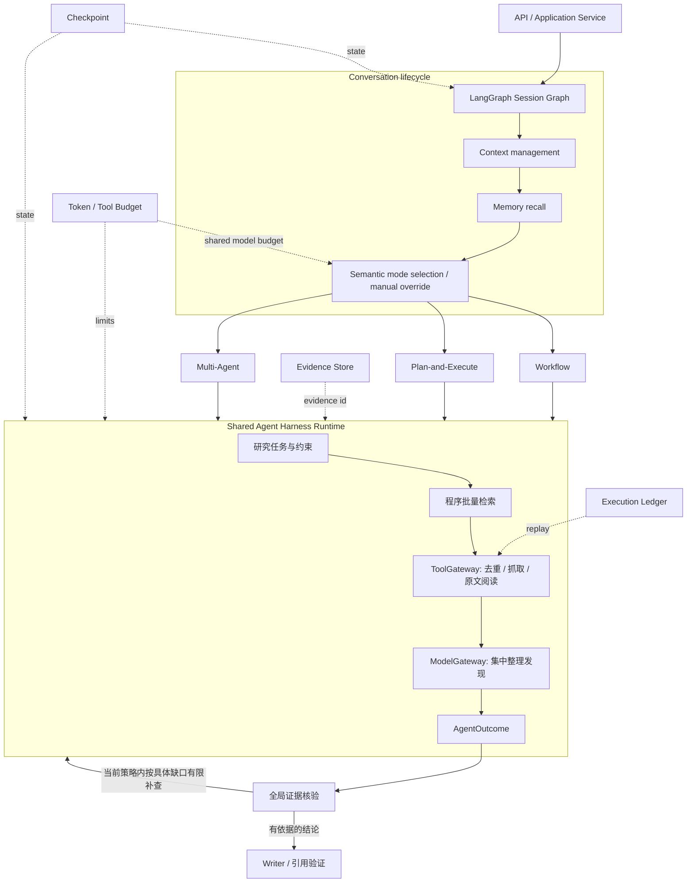

> 2026-11-19 更新：生产研究主干已精简为一次计划、有限收集与报告交付。当前行为以 [delivery-first-runtime.md](delivery-first-runtime.md) 为准；本文中逐轮覆盖评估、恢复和三套独立编排的说明属于历史实现，不再作为生产执行契约。

# Agent Harness 当前架构

本文描述当前代码中的运行边界和核心不变量。历史方案、阶段计划和已经被替换的 Topic 固定重试流程不再作为架构依据。

[可观测性与评测](langsmith.md)统一接入 LangSmith，复用 LangGraph/LangChain 原生调用树，工具执行由统一 Gateway 的 SDK span 关联。Checkpoint 继续负责恢复，Tool Ledger 继续负责幂等和预算。

新研究默认 `mode=auto`。`harness/mode_routing.py` 在既有预算内调用模型一次，识别步骤依赖与实质独立研究方向，再由宿主选择具体策略：有依赖选择 Plan-and-Execute，否则多个独立方向选择 Multi-Agent，其余选择 Workflow。三者使用独立编排子图（默认 `strategies`；`legacy` 为兼容别名），共享取材、预算与 Writer；显式 `controller` 保留统一内核作对照。

路由决定在 checkpoint 和 `research.routed` 事件中保存；运行详情中的 `mode` 表示请求选择，`selected_mode`、`routing_reason` 表示实际决定。补查保持本轮选中的策略，新的 auto 请求重新分析任务。普通追问等非研究意图跳过分类；显式指定模式也不调用分类模型。分类格式/请求失败回退 Workflow，取消及预算存储故障继续向上传播。

## 统一终止契约

`domain/run.py` 定义共享的 `TerminalStatus`、`FinishReason`、`ResearchSufficiency`。分支 `AgentOutcome`、应用 `ApplicationRunResult`、Worker `AgentResult` 和公开运行记录使用相同的四种终态：`completed / partial / failed / cancelled`。`pending / running / cancel_requested` 只属于运行生命周期，不能作为最终结果返回。

| 字段 | 含义 | 示例 |
| --- | --- | --- |
| status | 此次执行如何结束 | completed、partial、failed、cancelled |
| finish_reason | 稳定的终止原因分类，由原始原因派生 | completed、budget_exhausted、iteration_limit、planning_limit、model_error |
| termination_reason / stop_reason | 保留策略或历史运行的具体原因 | workflow_completed、max_replans_reached、max_iterations |
| research_sufficiency | 研究证据是否满足要求，与执行状态独立 | sufficient、insufficient、unknown、not_required |

SDK 结果通过 `finish_reason` 属性读取分类；运行详情 API 将其序列化为字段。非终态记录的分类为 `null`，无法识别的历史原因归为 `unknown`，不会被默认为成功。`termination_reason` 继续保留以兼容现有客户端与评测文件。

证据充分度使用现有 v2/v3 覆盖门禁核对固定需求、finding 和原文支持；仅有 `covered` 标签不能自动成为 `sufficient`。已有覆盖评估未通过或明确存在缺口时为 `insufficient`；历史记录或未执行评估时为 `unknown`；明确无需研究的会话为 `not_required`。这表示系统按当前证据契约作出的评估，不是事实正确性的外部保证。

例如固定 Workflow 完成取材并返回有缺口的回答，可以同时具有 `status=completed`、`finish_reason=completed`、`research_sufficiency=insufficient`，具体缺口保留在 `unresolved_gaps`。执行完成率与证据充分率须分别统计。

失败和取消可以没有 `response_outcome`，各运行适配器返回空回答并保留终态；完成或部分完成仍必须有回答结果。图调用异常与实际任务取消继续向外传播，由拥有执行生命周期的 Local Runtime / Worker 处理，避免破坏 Checkpoint 恢复和租约控制。

分布式部署更新代码前执行 `uv run alembic upgrade head`（工作目录 `backend`），新增 `research_runs.research_sufficiency` 列；旧行默认 `unknown`，不重新推断历史答案质量。本地运行记录为 JSON，旧文件缺失此字段时也读取为 `unknown`。原因分类不单独入库，避免两份原因不一致。

## 状态、模型视图与长期记忆

- State / Checkpoint 保存恢复运行所需的原始任务、约束、消息、计划和证据引用。
- `HarnessContext` 注入网关、Store、时钟等依赖，本身不是模型提示词。
- Context 策略在调用前从 State 生成有界模型视图；原始任务与约束固定保留，裁剪不改写历史 State。
- Memory Store 保存跨任务知识，通过召回与写入准入策略使用，不代替执行 Checkpoint。

三种策略复用同一个默认批量研究执行器；SDK 自由 Agent 使用通用 `build_tool_call_loop`。两种执行机制共用网关、预算、状态恢复和终止词汇，不要求固定流水线模拟模型工具循环。

## 研究证据变化与核验

三种研究策略共用 `strategies/evaluation_delta.py`，根据本次运行的任务作用域和证据变化决定核验范围。首次核验建立已接受结论与原文依赖；没有新原文时复用，不因轮次、预算或查询名称变化重新判断全部事实。新材料优先评估未完成需求，同时检查它是否影响旧结论；只有模型明确保留且宿主重新验证依赖的旧覆盖才能合并。

来源正文、版本、权限、任务约束或模型/规则变化会使相关复用失效；影响判断不完整或出现潜在冲突时重新扩大核验。失败的增量请求不会证明旧覆盖仍完整，也不会立即触发更大的整包请求。最终回答独立检查引用、重要结论和交付约束，优先应用局部修改。

核验账本保存在运行 State/Checkpoint，事件 `research.evaluation_scope` 区分 `full`、`delta`、`reused`。完整设计、调研与边界见[研究流程规范](../superpowers/specs/2026-11-19-incremental-research-flow-design.md)，真实模型数据见[增量实测](../benchmarks/2026-11-19-incremental-research-flow/README.md)。

## 工具执行账本与审计

外部能力调用经 `AgentToolGateway` 验证权限、参数、安全策略和预算；内部 `write_todos / record_findings / finish_research` 是宿主状态命令，由执行器校验并随 State 持久化。

工具注册、权限、参数、安全检查、preflight 或预算拒绝产生 `tool.rejected`；Ledger 重放产生 `tool.replayed`。这些事件只包含关联标识和稳定结果代码，不复制被拒绝的参数；它们不产生额外工具执行或预算扣费。`tool.started / tool.completed` 继续描述真实执行。

Ledger 负责副作用幂等与费用恢复，事件流负责拒绝、执行和重放的可观察性。拒绝发生在 Ledger claim 之前时不会创建执行记录；生产装配通过本地记录或 Worker 事件存储保留审计事件，独立 SDK 调用者需提供相应的 EventSink。

## 总体结构



架构分为两层：

- **Session Graph** 管理一轮对话的生命周期，包括上下文压缩、意图识别、长期记忆召回、策略路由、响应模式和记忆整理。
- **Shared Agent Harness Runtime** 管理研究分支的批量取材和集中整理。三种策略共享同一条取材与引用管道，负责各自的任务调度。

主要入口：

- [顶层 Session Graph](../../backend/src/deeptrace/harness/graph.py)
- [默认批量研究子图](../../backend/src/deeptrace/harness/batch_research.py)
- [按计划取材](../../backend/src/deeptrace/harness/batch_collection.py)
- [集中整理与一次格式修复](../../backend/src/deeptrace/harness/batch_synthesis.py)
- [运行时依赖](../../backend/src/deeptrace/harness/context.py)
- [组装入口](../../backend/src/deeptrace/application/assembly.py)

## 三种编排策略

| 策略 | 负责任务 | 适用场景 | 当前边界 |
| --- | --- | --- | --- |
| Workflow | 生成查询并汇总研究结果 | 边界清晰、需要快速覆盖 | 固定路径，灵活性较低 |
| Plan-and-Execute | 规划、逐项执行、评估并有界重规划 | 多步骤问题和资料缺口补全 | 计划不是依赖 DAG |
| Multi-Agent | Supervisor 拆解，多 Researcher 并行，聚合后评估 | 可拆成多个相对独立方向的问题 | 协调成本和重复检索风险更高 |

三种策略都通过标准 `ResearchInput` 接收任务，通过 `ResearchOutcome` 返回结果。策略内部状态不会泄漏到顶层 Session State。对应实现位于：

- [Workflow](../../backend/src/deeptrace/strategies/workflow/)
- [Plan-and-Execute](../../backend/src/deeptrace/strategies/plan_execute/)
- [Multi-Agent](../../backend/src/deeptrace/strategies/multi_agent/)

[strategies/common.py](../../backend/src/deeptrace/strategies/common.py) 统一输入归一化、研究分支调用、Outcome 校验、取消传播和部分完成的判定。策略节点只处理自己的计划、调度与状态更新，不再跨策略导入 Workflow 的公共函数。

Workflow 固定阶段执行结束返回 `completed / workflow_completed`，不补搜；证据覆盖与回答缺口独立保留。Plan-and-Execute 和 Multi-Agent 按原文支持的需求覆盖推进，核验失败可进入有上限的补查，预算耗尽或无进展时停止。事实审查发现修正后仍有用户要点未回答时，交付保留 `answer_review_incomplete`。执行完成与答案质量分别测量，详见[完成与取材优化](2026-10-11-research-completion.md)及[边界修复](2026-10-11-research-boundaries.md)。

## 研究到回答的共享证据交接

三种调度模式复用同一条证据管道，不各自复制评估和引用逻辑：

```text
成功 read_evidence → 元数据锚点 → 当前原文取材 → 当次可见短编号
                                                ↓
模型选择编号/判断语义 → 宿主构造原文支持 → 覆盖门禁 → Answer / Report
```

职责对应到独立模块：

| 职责 | 模块 | 边界 |
| --- | --- | --- |
| 读取交接 | domain/evidence_anchor.py、harness/read_anchors.py | 仅保存实际成功预览的来源版本/哈希/坐标；每分支64个唯一锚点，可checkpoint恢复，不直接证明事实 |
| 原文取材 | tools/evidence_units.py | 验收支持优先，其次读锚点，最后旧选择器；片段不跨缺口拼接，不改写正文 |
| 有界可见视图 | strategies/evaluation_materials.py | 最多8来源、每来源3000字符、128单位、每单位500字符；整体JSON再次验算token，仅当次可见单位有编号 |
| 引用解析 | strategies/evidence_references.py | 模型返回p1短段或g1完整阅读组，宿主生成EvidenceSupport；日期只用p编号，未知／隐藏／不完整组与重复finding ID拒绝 |
| 语义与完成门禁 | strategies/evidence_evaluation.py | 保留固定requirements、covered/missing/conflicting检查及既有策略动作，不把编号合法当成语义证明 |

新研究契约为v3；旧完成v2可读取，旧中途状态不能以新契约继续派发。短编号仅属于一次模型调用，不能作为持久证据；持久支持仍使用evidence_id/version/content_hash/原文坐标和quote。Writer将材料省略、验证失败等诊断与事实缺口分开，不将其解释为完整文档缺少相关说明。事实记忆仍需原有来源与原文支持准入。

这条管道将研究者实际读取的原文交给评估器，并由宿主解析模型选择的引用编号。检索相关性、语义判断和最终回答质量通过独立评测核对；公开运行的原始回答、配置和指标见[真实研究案例](../showcase/case-asyncio.md)。

共享原文选择器保留 API 基础命中，但普通参数标识符不独占整页阅读窗口；剩余空间按问题词相关性选择。明确限定 API 的查询仍保留其章节边界。Warning/Note 等提示块的规则与列表作为完整单元选取，超出预算时整体省略，且不能跨越实际读取范围。对应实现、失败回放和重复测试见[读取覆盖修复](../benchmarks/2026-11-09-query-coverage/README.md)。

## 默认批量研究路径

生产装配默认运行 `search → fetch → read → synthesize → finalize`。程序执行检索、URL 去重、并行抓取和带锚点的原文选段；模型接收一批原文，提交有引用的研究发现。每个分支通常一次整理调用，参数或引用不合法时最多一次修复。

首批默认选择最多三个不同来源，失败页面由剩余候选替换。已授权来源可以直接读取，避免重复抓取。原文、内容版本和引用锚点继续由既有 EvidenceStore 与 ToolGateway 保存和校验；模型只能引用本次输入可见的原文编号。分支取材完成与事实需求覆盖分开判定。

Plan-and-Execute 和 Multi-Agent 依据全局证据缺口安排最多两轮补查；补查没有新增证据时停止。Workflow 保持固定阶段的并行取材路径。

整个问题默认共享 20 次模型调用和 100,000 输入 token 的准入预算。并行分支在同一 run 的网关中原子预留额度；研究阶段保留最后两次调用给评估与回答。调用前按上下文估算准入，服务商返回 usage 后结算，缺少 usage 时保留估算值。研究阶段时间窗口默认 600 秒，收尾另留 120 秒。配置见环境模板。

## SDK 自由 Agent 循环

`build_research_agent_graph()` 保留供直接 SDK 调用与历史轨迹验证使用。下面描述该可选执行器；默认应用装配使用上面的批量子图。

编排已抽出到 [loop.py](../../backend/src/deeptrace/harness/loop.py)：`LoopNodes` 提供六个显式节点，循环仅处理模型、工具、观察、提醒和结果路由，不依赖 ResearchTopicInput 或 Finding。研究执行器继续提供领域节点；[独立文档任务](../../backend/src/deeptrace/examples/local_documents.py) 使用自己的 State/Context 和完成条件，复用相同循环与 Gateway。

工具通过 `ToolSpec` 注册，内置名称保留枚举校验，自定义名称使用 `CustomToolName`；宿主显式授予调用者能力，注册不会自动放权。[文档读取工具](../../backend/src/deeptrace/tools/local_documents.py) 校验目录、扩展名、文件大小和预览长度，仅作为只读扩展示例，不等同操作系统沙箱。

循环节点为：

```text
prepare_context
  → call_model（即时构造模型视图 → ModelGateway）
  → execute_tools 或 observe
  → execution policy
  → 下一轮或 finalize
```

`prepare_context` 只检查继续执行的条件。`call_model` 在调用 Provider 前从原始 State 构造本轮模型视图，视图是局部变量，不保存为重复的 `model_messages` Checkpoint 字段。旧快照即便带有此字段，恢复也以原始任务、约束和消息重新生成视图。

历史消息不会被原地截断；系统按完整的 assistant tool-call 批次及其 ToolMessage 结果成组裁剪，避免产生半个工具交换。节点名与工具执行后的恢复边界保持兼容。这与 [LangGraph 的原始状态和提示视图区分](https://docs.langchain.com/oss/python/langgraph/thinking-in-langgraph) 一致。

模型当前可见四个工具：

- `write_todos`：循环内计划状态工具，只修改可恢复 State，不经过外部 ToolGateway。
- `search_web`：外部搜索工具，必须经过 ToolGateway。
- `fetch_page`：外部抓取工具，必须经过 ToolGateway，并要求 URL 已由搜索结果或已抓取页面授权。
- `read_evidence`：只读已授权保存证据，返回带版本/哈希/坐标的有界完整JSON；实际成功读取锚点由宿主捕获。

共享循环采用证据优先路径：定位来源 → 抓取 → 读取完整相关原文 → `finish_research`。宿主收尾要求实际已读锚点当前仍已授权、ACTIVE且版本/哈希/坐标有效，已有todo必须完成；只抓取未阅读不能收尾。`record_findings`仍兼容旧轨迹，但不再是必经步骤。分支完成不代表全局充分：统一评估直接从原文抽取结论并核对固定需求，缺口仍走定向补查，Writer使用已接受findings。

原文阅读组与最多500字符的短引用分开；工具编号与评估预算按完整阅读组保留/省略，不将某条短引用本身视为完整语义证明。模型最多选3个p/g入口，宿主可保存当前128短段窗口内的展开引用。候选claim/confidence留档，但不再输入全局评估视图。补查规划仅接收结论、来源ID与缺口，避免重复全文挤占预算。

如果模型在计划未完成或没有足够证据时提前结束，Execution Policy 可以发送有界 completion nudge。达到迭代上限、连续错误上限、上下文上限、预算边界或取消条件时，循环进入 `finalize`。

## 上下文不变量

每次生产模型调用都必须包含：

1. 非空 system instruction；
2. original task；
3. current constraints。

[Context Policy](../../backend/src/deeptrace/harness/policies/agent_context.py) 在预算内固定保留这些内容，[ModelGateway](../../backend/src/deeptrace/harness/model_gateway.py) 在调用 Provider 前再次校验信封。较早的完整工具交换和可选背景可以被裁剪，任务与约束不能被裁剪。

信封使用 [TaskContext](../../backend/src/deeptrace/harness/model_context.py) 结构化元数据校验，HumanMessage 同时保留模型可见的任务与约束文本；不再扫描中文“原始任务／当前约束”标签。供应商 thinking、JSON 与角色超时选项集中于 [model_provider.py](../../backend/src/deeptrace/application/model_provider.py)。

批量整理默认以 6k 输入为目标，按完整来源片段组选择材料；没有被交给模型的原文编号不能用于提交发现。SDK 自由循环保留最近三组完整工具交换，并在剩余预算内保留较早阅读预览；其 6k 目标为软限制，硬窗口仍不可越过。持久轨迹和原文库完整保留。

Session Graph 的长期上下文采用滑动窗口和结构化摘要。摘要失败时仍执行确定性窗口裁剪，避免上下文无限增长。

## 模型与工具边界

所有生产模型调用必须经过 `ModelGateway`。它统一：

- 角色级模型参数覆盖；
- 工具 Schema 绑定；
- 上下文信封校验；
- 超时和 transport retry；
- 异常到稳定错误类别的映射。

消息内容解码与 JSON 对象提取统一在 [harness/model_io.py](../../backend/src/deeptrace/harness/model_io.py)。`strategies/model_io.py` 保留策略提示组装及有既有消费者的解析导入入口，不再承担上层 Harness 反向依赖的底层解析职责。

所有外部工具调用必须经过 [ToolGateway](../../backend/src/deeptrace/tools/gateway.py)。它统一：

- 调用者和工具白名单；
- 参数、URL 和公网地址校验；
- Run / Mode / Agent 预算预留；
- 缓存与 Singleflight；
- 执行账本与幂等重放；
- 超时、transport retry 和结构化失败；
- Evidence 持久化。

抓取来源键使用已通过安全边界的final URL（缺失则requested URL）。现有`canonical_url`字段承载实际来源键，发布者HTML canonical仅保存在metadata；不同版本/语言页面不再互相作废，同一实际URL正文更新仍supersede，不复活历史失效证据。

同一批调用中，无依赖调用通过信号量有界并行。`fetch_page` 如果依赖同批 `search_web` 产生的 URL 授权，会等待相关搜索结果。执行完成后，ToolMessage 按模型原始调用顺序写回，保证轨迹稳定。

每个 assistant tool call 最终都必须对应一个 ToolMessage。参数非法、未知工具、取消和终止性错误也会生成配对的失败消息，不能留下未闭合调用。

## 三种 retry 的归属

| 类型 | 所有者 | 处理内容 | 不负责什么 |
| --- | --- | --- | --- |
| Transport retry | ModelGateway / ToolGateway | 超时、连接错误、限流、可识别的临时服务错误 | 不修正查询语义和工具参数 |
| Semantic repair | 批量整理 / 策略补查 | 格式或引用错误最多修复一次；根据全局缺口安排新查询 | 不重复已经提交的外部副作用 |
| Recovery replay | Checkpoint / Worker / Ledger | 进程崩溃、节点重放和 at-least-once 投递后的恢复 | 不把业务失败伪装成成功 |

每类重试只有一个主要所有者。生产模型网关采用单次传输尝试，由共享运行预算限制实际请求数量；工具网关保留有限传输重试，恢复时优先读取 Ledger 已提交结果。

## 响应生成：一条有界纠错路径

ANSWER / BRIEF / REPORT 共用 ResponsePolicy 与 `load_evidence → generate → validate`。每次 generate 先生成候选，一次检查解析、引用标记、篇幅和悬空结尾；存在问题时合并为一次纠错请求。不再将解析、引用、篇幅修复串联为多次模型请求。

一次 generate 执行最多两次业务层 ModelGateway 调用。Gateway 的 transport retry 和 Checkpoint 重放不在该局部次数保证内。纠错解析失败保留可解析的首稿；最终正文仍超长时按既有句子边界确定性截断，再由引用校验节点形成 ResponseOutcome 或来源清单降级。Provider 错误和取消不伪装成格式问题。

消息解码复用 `harness/model_io.py`，支持 AIMessage 的字符串与文本块；响应模块仅保留 content JSON 契约及散文包裹 JSON 的兼容解析。证据正文只读取一次并局部复用，预算、节点名和恢复边界不变。此次没有改变 Provider 协议或接入新的结构化输出 SDK。

实现与回归见 [响应图](../../backend/src/deeptrace/responses/graph.py) 和 [响应测试](../../backend/tests/responses/test_graph.py)。

## 研究执行入口与迁移

生产装配的三个研究策略统一使用 `deeptrace.harness.batch_research.build_batch_research_graph`。策略安排研究任务和缺口补查，批量执行器完成取材与集中整理。`deeptrace.harness.agent_executor.build_research_agent_graph` 保留为可选 SDK 入口，其自由工具循环与现有测试继续有效。

旧 Python 入口 `deeptrace.strategies.build_research_topic_graph` 及 `deeptrace.strategies.topic` 的节点、状态导出已移除。调用者需直接导入新入口，注入支持 `researcher` 角色及 `tools` 参数的 ModelGateway；不能将此次替换理解为仅改函数名的行为兼容。

`ResearchTopicInput`、`ResearchTopicOutcome` 和 `TopicStepError` 领域契约仍保留。新批量子图具有独立的 search / fetch / read / synthesize 检查点。旧自由循环的未完成快照应由原版本完成，或创建新任务；已完成的研究记录仍可读取。持久化检查点、执行账本与证据存储继续复用。

测试只脚本化外部模型和搜索 / 抓取服务。ToolGateway、证据存储、Executor 与 Checkpoint 仍执行真实逻辑；并发研究分支根据自己的消息历史取得响应，不共享模型响应游标。脚本成本基线包含 researcher 调用，不代表真实 Provider 的质量、Token 成本或端到端延迟。

## AgentOutcome 与退出治理

[AgentOutcome](../../backend/src/deeptrace/domain/agent.py) 不只是 `stop_reason`，还包含：

- `status`：`completed`、`partial`、`failed` 或 `cancelled`；
- `summary` 和 `evidence_ids`；
- 结构化 `errors`；
- `iterations` 与 `executed_steps`；
- `budget` 快照；
- `plan_total`、`plan_completed` 和 `unfinished_todos`。

[Execution Policy](../../backend/src/deeptrace/harness/policies/execution.py) 负责继续、提示和停止决策，输出通用 `AgentOutcome`。Executor 包装为研究分支的 `ResearchTopicOutcome`，策略再汇总为 `ResearchOutcome`；停止策略不负责研究查询、URL 等业务包装。State、Policy 与 Outcome 共用 `AgentStatus` / `AgentStopReason` 类型定义。

## 记忆、证据和可恢复状态

三类数据的所有权不同：

- **State / Checkpoint**：保存可序列化、可恢复的控制状态、消息、计划、Evidence ID 和 Outcome。
- **Runtime Context**：注入模型、工具、时钟、Store 等进程资源，不写入 Checkpoint。
- **Evidence Store**：保存网页正文、来源和内容哈希；State 只保存 Evidence ID。

[Memory Lifecycle](../../backend/src/deeptrace/harness/memory/lifecycle.py) 负责按意图召回、处理用户显式记忆请求，并在研究完成后整理带证据的事实。权威记录保存在结构化 Store；Chroma 只承担候选内语义检索，命中后回查权威记录。

长期记忆只在主链路自动使用用户偏好和工作区研究事实。写入执行准入策略和原子版本更新；召回先取每个身份的最新版本，再检查状态、有效期与相关性。注入有条数 / token 双重预算与来源标识，当前用户要求优先。显式保存失败会说明未保存，自动整理失败不使研究失败。完整设计见 [记忆模块](memory.md)。

[Checkpoint serializer](../../backend/src/deeptrace/harness/checkpoint.py) 显式注册 Agent State、Todo 和 Outcome 类型。工具节点完成后有独立 Checkpoint 边界；恢复后仍要求模型上下文完整、工具调用配对、Gateway 边界和最终 Outcome 不变量成立。

## Token 与调用预算

当前预算覆盖三个层次：

- 模型上下文采用保守 Token 估算，固定保留指令、原始任务、当前约束和输出空间，再按完整交换裁剪历史。
- 外部工具在执行前按 Run / Mode / Agent 预留调用次数和网络额度，并在成功、失败或取消后提交或释放。
- 默认批量运行共享模型请求、输入准入与时间预算，并为核验和回答保留额度。调用前将次数与保守预留写入 SQL 快照，恢复已消耗额度、原始限制与开始时间，停机时间计入期限；版本条件更新拒绝旧快照覆盖。读取、保存、损坏或冲突失败时拒绝继续派发。

`AgentOutcome.budget` 仍是执行统计；[ModelMetrics](../../backend/src/deeptrace/observability/model_metrics.py) 单独记录供应商已返回的 usage、缺失次数和角色累计模型耗时。缺失一次 usage 就将实际总 input/output/total 置为 null，保留 observed_usage；准入估算不会充当实测。尝试次数记录准入后的 Gateway 调用，校验失败可能尚未触达供应商。生产正常路径没有内部重试；自定义网关若内部重试，需要独立计量。

模型返回、快照和 Checkpoint 之间没有跨服务原子事务。崩溃留下的预留可能多算；返回结果／实际用量可能未知。它是保守准入，不能称为精确账单或 exactly-once。

Local 与 Worker 终态接入实际用量，包括可取得的失败／取消用量，前端显示调用数和完整或未知 Token 用量。模型开始／完成／失败事件只公开调用 ID、角色、耗时、用量和稳定错误，不公开 prompt。终态释放每 run 的网关与 recorder，持久记录保留。Local 的启动行为仍标记中断任务，持久预算不等于已实现自动续跑产品。

## 当前验证边界

2026-10-01 的离线验收覆盖以下关键不变量，具体命令与最终结果见 [记忆模块验收记录](memory.md#验证)：

- [Agent loop tests](../../backend/tests/harness/test_agent_executor.py)
- [Cross-cutting invariant tests](../../backend/tests/harness/test_agent_invariants.py)
- [ModelGateway tests](../../backend/tests/harness/test_model_gateway.py)
- [Memory lifecycle tests](../../backend/tests/harness/memory/test_lifecycle.py)
- [Memory transactions tests](../../backend/tests/harness/memory/test_memory_transactions.py)

离线测试覆盖模型上下文信封、tool-call / ToolMessage 配对、Gateway 边界、AgentOutcome、并行工具顺序、旧 Checkpoint 恢复，以及内存 / SQLite 的记忆并发版本、事务回滚、遗忘和召回过滤。真实 Provider、Tavily、MySQL、Redis 和 Chroma 需要凭据或外部服务，不写成已完成的本次验收。

2026-10-10 的运行时优化与验收见 [实现记录](2026-10-10-harness-runtime-implementation.md)。当前演进方向包括模型增量输出、受隔离命令与敏感写入、认证后的租户隔离、通用 Human-in-the-loop 审批、内容级 Prompt Injection 检测与系统化在线 Agent Eval。
